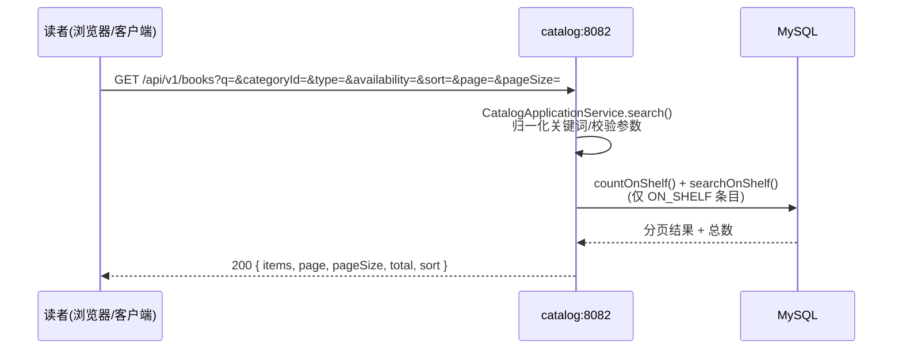
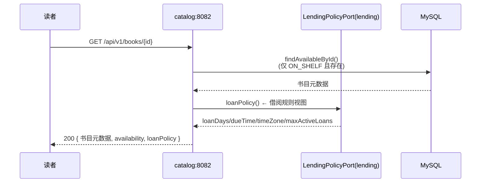
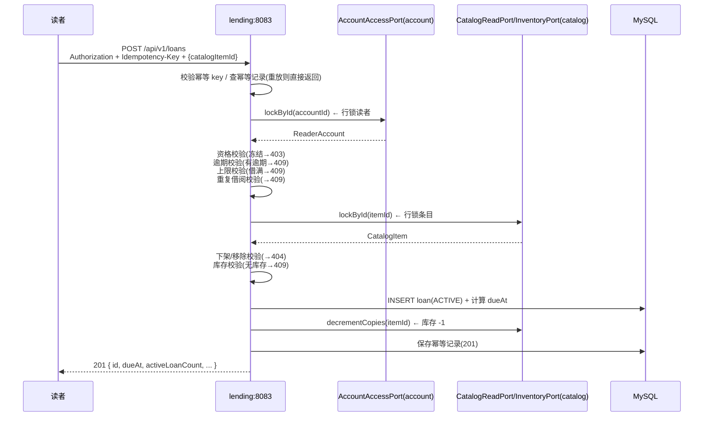
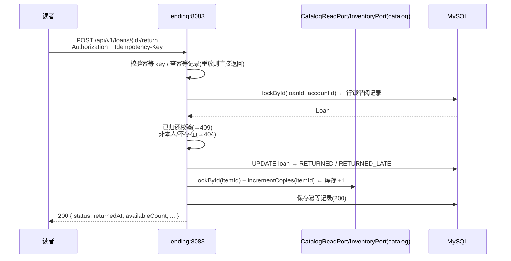
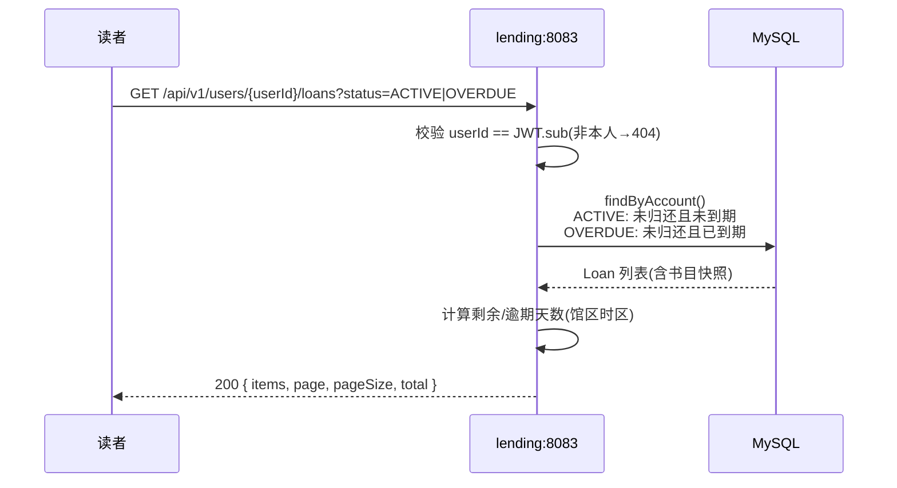

# E-Library MVP — 微服务架构

电子图书馆服务 MVP。**account / catalog / lending 三个独立 Spring Boot 服务**共享一个 `common` 工程，单 MySQL 数据库由 Flyway 管埋。读者身份取自已校验 JWT 的 `sub` 声明。

## 目录

- [架构](#架构)
- [代码结构](#代码结构)
- [服务描述与接口](#服务描述与接口)
- [快速开始](#快速开始)
- [配置项](#配置项)
- [测试](#测试)
- [构建](#构建)
- [API 清单](#api-清单base-path-apiv1)
- [已验证的端到端链路](#已验证的端到端链路)
- [JWT / JWK 本地联调](#jwt--jwk-本地联调)
- [需求场景与调用链](#需求场景与调用链)

## 文档索引

| 文档 | 说明 |
|---|---|
| [tech-mvp.md](./tech-mvp.md) | 核心技术方案：架构总览、数据模型、核心业务设计、API 契约、DDD、错误处理、代码可维护性、测试策略、交付部署、演进路线 |
| [docs/validation.md](./docs/validation.md) | **验收文档**：Quickstart 启动步骤 + 全场景 curl 命令与预期结果 + 停止服务 |
| [docs/curl-scenarios.md](./docs/curl-scenarios.md) | curl 场景测试明细：覆盖全部 API 场景的调用与预期 |
| [README.md](./README.md) | 本文档：架构、服务接口、快速开始、配置、测试、构建、API 清单 |

## 代码结构

```text
library-service/
├── settings.gradle / build.gradle        # 多模块 Gradle 工程（common + 3 业务模块）
├── compose.yaml                          # 本地开发：MySQL + JWK 服务器（Docker）
├── compose.test.yaml                     # 测试环境：MySQL + 测试运行容器
├── Dockerfile                            # 单服务镜像（--build-arg SERVICE）
├── Dockerfile.test                       # 测试镜像
├── docker/jwk/                           # 本地联调 JWK/JWT 服务器（Python HTTPS）
│   ├── jwk_server.py                     #   /jwks 公钥 + /token 签发
│   ├── Dockerfile / cert.pem / jwks.json / key.pem
├── scripts/
│   ├── setup-local.sh                    # 一键启动基础设施 + 证书 + JWT
│   ├── start-services.sh                 # 构建并启动三服务（已运行则重启）
│   ├── reset-test-data.sql               # 重置测试数据（含种子数据）
│   └── verify-scenarios.sh               # 52 场景自动断言
├── docs/
│   ├── validation.md                     # 验收文档（Quickstart + 场景 curl + 预期）
│   └── curl-scenarios.md                 # curl 场景测试明细
│
├── common/                               # 共享工程（契约/配置/基础设施）
│   └── src/main/
│       ├── java/com/elibrary/
│       │   ├── common/                   # 统一响应/异常/分页、UUID、时间、TraceFilter
│       │   └── config/                   # Security(JWT)、TimeConfig、LoanProperties、
│       │                                 #   ElibraryCommonAutoConfiguration
│       └── resources/
│           ├── elibrary-common.yml       # 共享配置（数据源/JWT/MyBatis/借阅策略）
│           ├── db/migration/V1__init.sql # Flyway 迁移（5 张表）
│           └── META-INF/spring/          # AutoConfiguration 注册
│
├── account/                              # 账号服务（:8081）
│   └── src/main/java/com/elibrary/account/
│       ├── AccountApplication.java       # 启动类
│       ├── api/                          # AccountController（GET /accounts/me）
│       ├── application/                  # AccountApplicationService、AccountAccessPort、
│       │                                 #   LoanCountPort、LoanCountReader
│       ├── domain/                       # ReaderAccount、AccountStatus
│       └── infrastructure/               # AccountMapper、AccountRepository、LoanCountMapper
│
├── catalog/                              # 目录服务（:8082）
│   └── src/main/java/com/elibrary/catalog/
│       ├── CatalogApplication.java       # 启动类
│       ├── api/                          # BookController、CategoryController
│       ├── application/                  # CatalogApplicationService、CatalogReadPort、
│       │                                 #   CatalogInventoryPort/Service、SearchCriteria
│       ├── domain/                       # CatalogItem、Category、ShelfStatus
│       └── infrastructure/               # CatalogMapper、CatalogItemRepository
│
└── lending/                              # 借阅服务（:8083）
    ├── src/main/java/com/elibrary/lending/
    │   ├── LendingApplication.java       # 启动类（@Import account/catalog 实现）
    │   ├── api/                          # LoanController、UserLoansController、OperationController
    │   ├── application/                  # BorrowLoan、ReturnLoan、LoanQueryService、
    │   │                                 #   IdempotencyService、LoanRepository、LendingPolicyService
    │   ├── domain/                       # Loan、LoanPolicy、DueDateCalculator
    │   └── infrastructure/               # LoanMapper、IdempotencyMapper
    └── src/test/java/com/elibrary/lending/
        ├── sqlite/                       # SQLite 功能测试（52 场景，无需 Docker）
        ├── architecture/                 # ArchUnit 架构规则测试
        └── domain/                       # DueDateCalculator 单元测试
```

> 分层约定（Clean Architecture）：`api`（HTTP 适配）→ `application`（用例/端口）→ `domain`（纯领域）→ `infrastructure`（MyBatis 实现）。
> 依赖方向单向：`api → application → domain`，`infrastructure` 实现 `application` 定义的端口。

## 架构

```text
读者端
  │  HTTPS (JWT)
  ▼
┌──────────────────────────────────────────────────────┐
│  account:8081    catalog:8082    lending:8083        │
│  (Spring Boot 3 / Java 21 独立进程)                   │
└───────────────────────┬──────────────────────────────┘
                        ▼
                 MySQL 8.4 (elibrary_db)
```

- **common** — 共享契约与基础：统一响应/异常/分页、JWT 资源服务器、时钟、Flyway 迁移、借阅策略配置（`elibrary.loan.*`）、MyBatis UUID 处理器。
- **account** — 账号资格服务：查询读者账号状态与借阅资格。
- **catalog** — 目录服务：浏览分类、检索书籍、查看书籍详情。
- **lending** — 借阅服务：借阅、归还、个人借阅记录、幂等操作结果查询。

模块间只通过 Java 接口调用（`AccountAccessPort`、`CatalogReadPort`、`CatalogInventoryPort`、`LoanCountPort`、`LendingPolicyPort`）；沿模块边界即可拆分为独立部署单元。

## 服务描述与接口

### account（账号服务）— `:8081`

读者账号与借阅资格查询。账号的创建/冻结/注销由受信任渠道完成，不开放读者 API。

| 接口 | 认证 | 功能 |
|---|---|---|
| `GET /api/v1/accounts/me` | 必须 | 返回本人账号状态（`status`）、资格等级（`eligibilityLevel`）、是否可借（`borrowingEligible`）、不可借原因（`eligibilityReasons`）、当前有效借阅数（`activeLoanCount`）与上限（`activeLoanLimit`） |

**内部依赖**：通过 `LoanCountPort` 调用 lending 统计有效/逾期借阅数；通过 `LendingPolicyPort` 读取借阅上限。

### catalog（目录服务）— `:8082`

书籍目录浏览与检索，匿名可访问。

| 接口 | 认证 | 功能 |
|---|---|---|
| `GET /api/v1/categories` | 匿名 | 分类列表（仅含上架条目的 ACTIVE 分类，按 `sortOrder` 排序） |
| `GET /api/v1/books` | 匿名 | 检索/筛选/分页目录：`q` 关键词（NFKC 归一化、`%`/`_` 转义、≤100 字符）、`categoryId`、`type`（EBOOK/PERIODICAL）、`availability`（仅可借）、`sort`（publishedAt_desc/title_asc/title_desc）、`page`/`pageSize`（≤100） |
| `GET /api/v1/books/{id}` | 匿名 | 书籍详情：书目元数据、库存状态（`availability`）、借阅规则（`loanPolicy`：借期/应还时刻/时区/上限） |

**内部依赖**：详情接口通过 `LendingPolicyPort` 读取借阅规则展示给读者。

### lending（借阅服务）— `:8083`

借阅/归还/个人记录/幂等结果，是业务核心，跨模块调用 account 与 catalog。

| 接口 | 认证 | 功能 |
|---|---|---|
| `POST /api/v1/loans` | 必须 | 借阅书籍（需 `Idempotency-Key`）：校验资格→逾期→上限→重复→库存，成功则落 Loan 并扣库存，返回 `201` |
| `POST /api/v1/loans/{id}/return` | 必须 | 归还（需 `Idempotency-Key`）：锁 Loan→写归还状态（逾期则 `RETURNED_LATE`）→回补库存，返回 `200` |
| `GET /api/v1/users/{userId}/loans` | 必须且本人 | 个人借阅列表，`status` 筛选（ACTIVE/OVERDUE/COMPLETED），含剩余/逾期天数 |
| `GET /api/v1/loans/{id}` | 必须且本人 | 单条借阅详情（含书目快照、状态、天数） |
| `GET /api/v1/loan-operations/{idempotencyKey}` | 必须且本人 | 查询幂等操作结果（网络结果未知时取回原响应） |

**内部依赖**：借阅/归还通过 `AccountAccessPort` 锁读者、`CatalogReadPort` 锁条目、`CatalogInventoryPort` 调整库存；`LendingPolicyPort` 提供借阅规则默认实现。

## 快速开始

> **Docker 方案**：`compose.yaml` 提供 MySQL 8.4 与 JWK 服务器（本地联调用），三个服务在本地 JVM 启动。
> 镜像构建（`Dockerfile`）仅用于生产部署，本地开发不构建镜像。

### 1. 一键启动基础设施（推荐）

```bash
./scripts/setup-local.sh   # 启动 MySQL + JWK 容器，导入证书，签发测试 JWT
```

或手动：

```bash
docker compose up -d mysql jwk   # MySQL 8.4（:3306）+ JWK 服务器（HTTPS :9443）
```

### 2. 本地启动三个服务（JVM）

```bash
./scripts/start-services.sh   # 构建 + 启动三个服务（已运行则自动重启）
```

脚本自动完成：构建 jar、检测端口占用（已运行则先停止再重启）、启动三个服务、等待就绪并输出健康检查。

> 环境变量默认值已内置（`DB_URL`/`DB_USERNAME`/`DB_PASSWORD`/`JWT_*`），如需覆盖可先 `export` 再运行。
> 也可手动启动：

```bash
export DB_URL='jdbc:mysql://127.0.0.1:3306/elibrary_db?connectionTimeZone=UTC&forceConnectionTimeZoneToSession=true'
export DB_USERNAME=elibrary DB_PASSWORD=elibrary-local
export JWT_ISSUER_URI=https://issuer.example.com JWT_AUDIENCE=elibrary-api
export JWT_JWK_SET_URI=https://localhost:9443/jwks   # 本地联调 JWK 端点

./gradlew :account:bootRun --args='--server.port=8081'   # account  :8081
./gradlew :catalog:bootRun --args='--server.port=8082'   # catalog  :8082
./gradlew :lending:bootRun --args='--server.port=8083'   # lending  :8083
```

健康检查：`curl localhost:8081/actuator/health/readiness`（catalog/lending 同理）。
JWT 签发与证书导入见 [JWT / JWK 本地联调](#jwt--jwk-本地联调)。

## 配置项

| 环境变量 | 默认值 | 说明 |
|---|---|---|
| `DB_URL` | `jdbc:mysql://localhost:3306/elibrary_db?...` | 数据库连接（UTC 会话时区） |
| `DB_USERNAME` / `DB_PASSWORD` | `elibrary` / `elibrary-local` | 数据库凭据（仅本地默认值） |
| `JWT_ISSUER_URI` | `https://issuer.example.com` | OIDC issuer，用于签名校验 |
| `JWT_JWK_SET_URI` | 空 | 固定 JWK 端点（无 issuer 发现时） |
| `JWT_AUDIENCE` | `elibrary-api` | 期望的 audience |
| `LOAN_MAX_ACTIVE` | `5` | 同时有效借阅上限 |
| `LOAN_DAYS` | `14` | 借期（本地自然日） |
| `LOAN_DUE_TIME` | `23:59:00` | 应还时刻 |
| `LIBRARY_ZONE` | `Asia/Shanghai` | 馆区时区 |
| `LOAN_POLICY_VERSION` | `v1` | 随 Loan 落库的策略版本 |
| `IDEMPOTENCY_RETENTION_DAYS` | `7` | 幂等记录保留天数 |

## 测试

```bash
./gradlew test        # 单元测试 + SQLite 功能测试 + Testcontainers 集成测试（无 Docker 时自动跳过）

# 或在容器内跑指定服务测试（可选）
SERVICE=lending docker compose -f compose.test.yaml run --rm test
```

### 功能测试（SQLite）

覆盖 README「需求场景与调用链」与 [docs/curl-scenarios.md](./docs/curl-scenarios.md) 全部场景的功能测试位于
`lending/src/test/java/com/elibrary/lending/sqlite/`，使用**内存 SQLite**（`sqlite-jdbc`）替代 MySQL，
无需 Docker 即可运行：

| 测试类 | 覆盖场景 |
|---|---|
| `AccountEligibilityScenarioTest` | 账号资格（正常/冻结/逾期/不存在） |
| `CatalogScenarioTest` | 目录浏览/检索/筛选/分页/详情（18 个场景） |
| `BorrowScenarioTest` | 借阅（幂等/冻结/逾期/借满/库存/下架/移除/非法 ID） |
| `ReturnScenarioTest` | 归还（正常/重复/他人/逾期/不存在/移除条目） |
| `LoanQueryScenarioTest` | 个人记录（状态筛选/越权）+ 幂等操作查询 |

```bash
# 仅运行 SQLite 功能测试
./gradlew :lending:test --tests "com.elibrary.lending.sqlite.*"
```

> SQLite 版 Mapper 实现主接口（`AccountMapper`/`CatalogMapper`/`LoanMapper`/`IdempotencyMapper`），
> 通过 `@TestConfiguration` 的 `@Primary` bean 覆盖，业务逻辑（`BorrowLoan`/`ReturnLoan`/查询服务）零改动复用。

### 端到端场景验证（curl）

**验收文档**：[docs/validation.md](./docs/validation.md) 提供 Quickstart 启动步骤 + 全场景 curl 命令与预期结果。
覆盖全部 API 场景的 curl 调用文档见 [docs/curl-scenarios.md](./docs/curl-scenarios.md)，
自动断言脚本为 `scripts/verify-scenarios.sh`（52 个场景，已全部验证通过）：

```bash
# 1. 重置测试数据（脚本会改变数据库状态，每次运行前执行）
docker exec -i library-service-mysql-1 mysql -uelibrary -pelibrary-local elibrary_db < scripts/reset-test-data.sql

# 2. 运行验证（需三服务运行中 + JWT + JWK 服务器）
./scripts/verify-scenarios.sh
```

## 构建

```bash
./gradlew :account:bootJar :catalog:bootJar :lending:bootJar
# 产出 account/build/libs/account-app.jar、catalog-app.jar、lending-app.jar

# 单服务镜像（仅生产部署用，本地开发不构建）
docker build --build-arg SERVICE=account -t elibrary-account .
docker build --build-arg SERVICE=catalog -t elibrary-catalog .
docker build --build-arg SERVICE=lending -t elibrary-lending .
```

- Flyway 迁移：`common/src/main/resources/db/migration/`（禁止生产自动建表）。
- 认证：Spring Security OAuth2 Resource Server，校验 issuer/audience/exp/签名；`sub` 即 `accountId`；不信任请求体中的读者 ID。
- 幂等：`Idempotency-Key` + 请求摘要比对；`GET /loan-operations/{key}` 取回原结果。

## API 清单（Base Path `/api/v1`）

| Method / Path | 认证 | 服务 | 用途 |
|---|---|---|---|
| `GET /accounts/me` | 必须 | account | 本人账号状态与借阅资格 |
| `GET /categories` | 匿名 | catalog | 有上架条目的分类列表 |
| `GET /books` | 匿名 | catalog | 检索/筛选/分页目录 |
| `GET /books/{id}` | 匿名 | catalog | 图书详情 |
| `POST /loans` | 必须 | lending | 借阅（需 `Idempotency-Key`） |
| `POST /loans/{id}/return` | 必须 | lending | 归还（需 `Idempotency-Key`） |
| `GET /users/{userId}/loans` | 必须且本人 | lending | 个人借阅列表 |
| `GET /loans/{id}` | 必须且本人 | lending | 单条借阅详情 |
| `GET /loan-operations/{idempotencyKey}` | 必须且本人 | lending | 查询幂等操作结果 |

完整业务规则、错误码与接口契约见 [tech-mvp.md](./tech-mvp.md)。

## 已验证的端到端链路

本地启动（MySQL 在 Docker，服务在 JVM）后已验证：

1. `GET /accounts/me` → 账号状态与借阅资格（`borrowingEligible`）
2. `POST /loans` → 借阅成功，库存 `available_copies` 递减
3. 同 `Idempotency-Key` 重放 → `201` + `Idempotent-Replay: true`，不重复借阅
4. `GET /users/{userId}/loans` → 个人记录（馆区时区、剩余/逾期天数）
5. `POST /loans/{id}/return` → 归还，库存回补

## JWT / JWK 本地联调

三个服务通过 Spring Security OAuth2 Resource Server 校验 JWT（签名/issuer/audience/exp），`sub` 即 `accountId`。

**登录与 token 获取**：登录/注册/凭证管理**不在 MVP 范围**，由 OIDC Provider（如 Keycloak）承接——读者登录后由 Provider 签发 JWT，客户端携带 `Authorization: Bearer <JWT>` 访问。三个服务只**验证** token，不签发、不管理凭证。本地无 Provider 时，用 **Docker 中的 JWK 服务器**（自签名证书 + 静态 JWK 端点）闭环验证：`/token` 模拟登录签发，`/jwks` 模拟公钥分发。

### 一键启动（推荐）

```bash
./scripts/setup-local.sh
```

脚本自动完成：启动 MySQL + JWK 容器、导入证书到 JVM、签发测试 JWT 到 `/tmp/jwt-u1.jwt` ~ `/tmp/jwt-u4.jwt`（及 `/tmp/test.jwt`）。

### JWK 服务器端点

`compose.yaml` 的 `jwk` 服务（`docker/jwk/`，Python HTTPS 服务器）提供：

| 端点 | 说明 |
|---|---|
| `GET https://localhost:9443/jwks` | JWK 公钥（服务校验 JWT 签名用） |
| `GET https://localhost:9443/token` | 签发测试 JWT（默认 `sub=U1`，可用 `?sub=<uuid>` 指定账号） |

```bash
curl -sk https://localhost:9443/token                    # 获取 U1 的 JWT
curl -sk "https://localhost:9443/token?sub=00000000-0000-0000-0000-000000000003"  # U3 的 JWT
```

### 启动服务

```bash
export JWT_ISSUER_URI=https://issuer.example.com
export JWT_JWK_SET_URI=https://localhost:9443/jwks
export JWT_AUDIENCE=elibrary-api
```

> `docker/jwk/` 下的 `key.pem`/`cert.pem`/`jwks.json` 为**本地联调专用**（非生产密钥），随仓库提供保证开箱即用；生产密钥由 Secret 注入。
> 匿名路径：`GET /api/v1/categories`、`GET /api/v1/books`、`GET /api/v1/books/**` 及 actuator 健康检查。

## 需求场景与调用链

以下按需求拆解所有场景，说明每个场景的调用链流程。模块间调用均为**进程内 Java 接口调用**（当前单进程部署），沿端口契约即可拆为独立服务。

### 场景 1：浏览书籍（目录检索）

**需求**：读者浏览可借书籍列表。

**调用链**：



**要点**：匿名可访问；关键词 NFKC 归一化、`%`/`_` 转义；`availability=true` 仅返回有库存条目；页码越界自动收敛到最后一页。

### 场景 2：查询书籍详细资料

**需求**：读者查看某本书的完整信息与借阅规则。

**调用链**：



**要点**：下架/移除/不存在的条目返回 `404 BOOK_NOT_FOUND`；非法 ID 返回 `400`；详情附带 `loanPolicy` 让读者借阅前了解规则。

### 场景 3：借阅书籍

**需求**：读者借阅一本可借的书。

**调用链**（lending 跨模块调用 account 与 catalog，同一事务）：



**要点**：`Idempotency-Key` 必填（缺→400）；同 key 同载荷重放返回原结果 + `Idempotent-Replay: true`；同 key 异载荷→409；借阅与扣库存同事务，失败整体回滚。

### 场景 4：归还书籍

**需求**：读者归还已借的书。

**调用链**：



**要点**：逾期归还状态为 `RETURNED_LATE`；下架/移除的条目仍可归还（库存回补跳过）；归还与库存回补同事务。

### 场景 5：查看目前已借阅的书籍

**需求**：读者查看自己当前借阅的书籍（含逾期）。

**调用链**：



**要点**：`userId` 必须等于 JWT 的 `sub`（不信任请求体）；`status` 仅允许 ACTIVE/OVERDUE/COMPLETED（非法→400）；单条详情 `GET /loans/{id}` 同理须为本人；网络结果未知时可用 `GET /loan-operations/{key}` 取回借阅/归还原响应。

### 场景与接口映射

| 需求 | 主接口 | 涉及服务 |
|---|---|---|
| 浏览书籍 | `GET /books` | catalog |
| 查询书籍详细资料 | `GET /books/{id}` | catalog（+ lending 借阅规则） |
| 借阅书籍 | `POST /loans` | lending（+ account 资格 + catalog 库存） |
| 归还书籍 | `POST /loans/{id}/return` | lending（+ catalog 库存） |
| 查看目前已借阅的书籍 | `GET /users/{userId}/loans` | lending |
