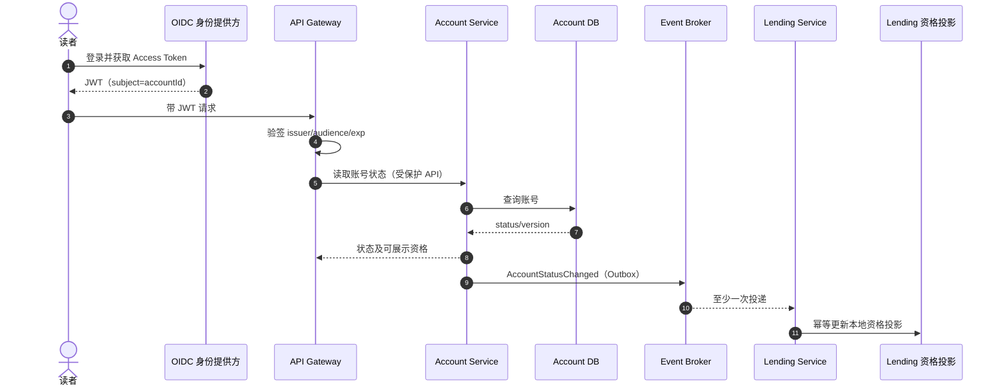
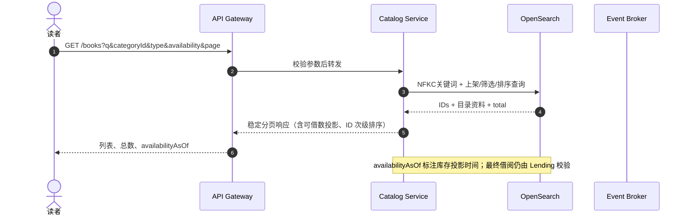
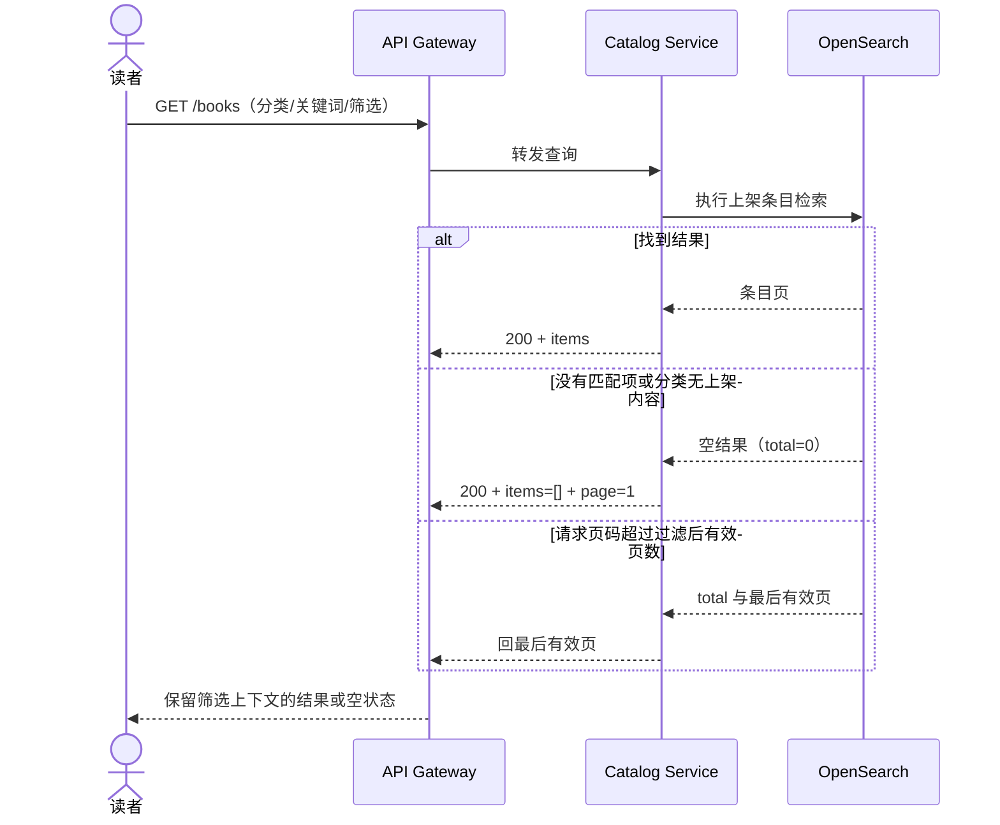
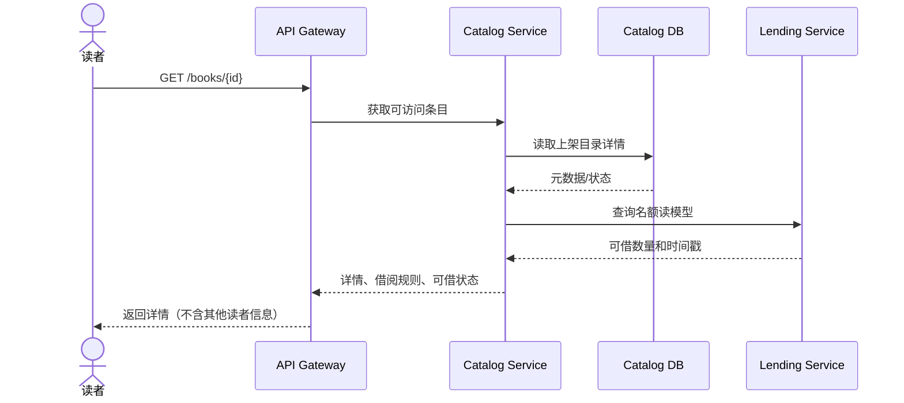
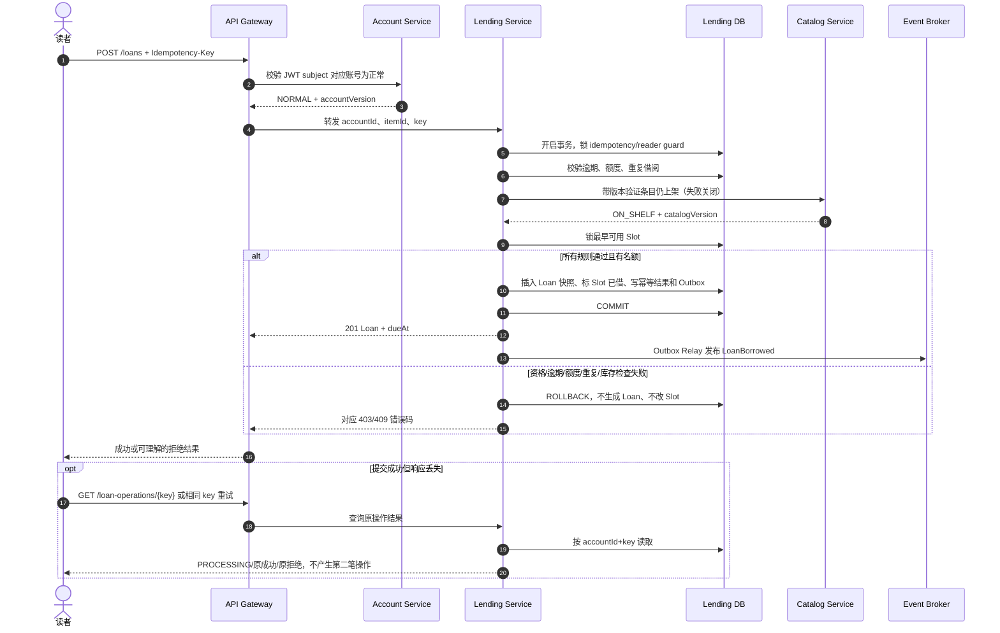
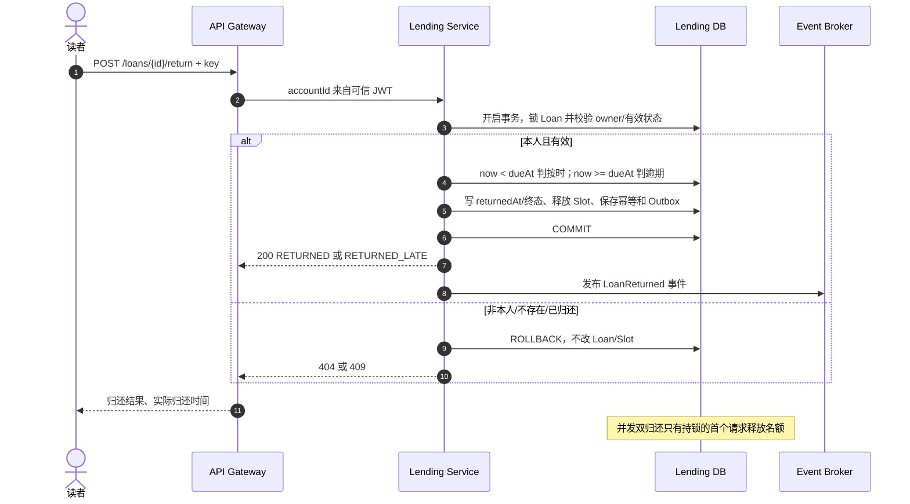
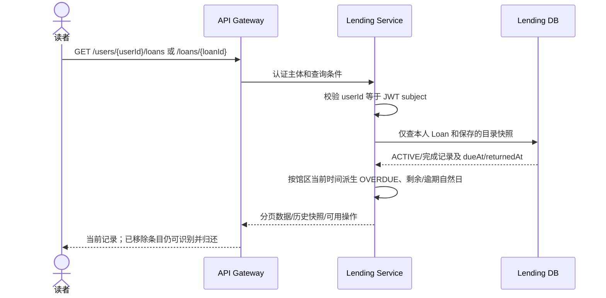
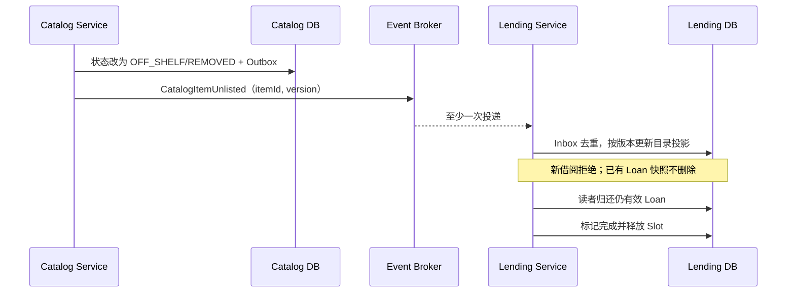
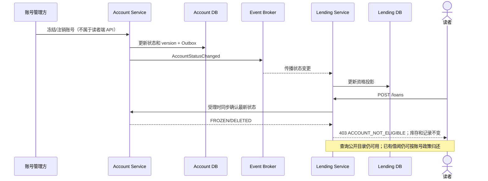
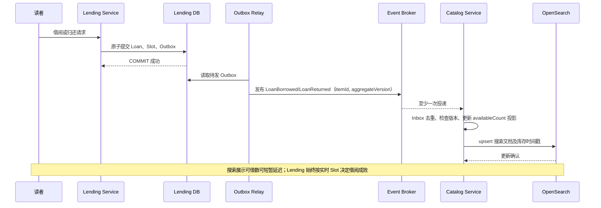

# 电子图书馆服务 (E-Library Service) 后端技术设计文档

> 版本：1.1（微服务修订版，基于 `product-doc.md`）
> 范围：读者账号状态查询、目录浏览/详情、借阅、归还、个人借阅记录。账号注册、凭证管理与身份认证可由统一身份平台承接；本系统包含 Account Service 作为账号资料及借阅资格权威模块。目录维护、馆员后台、通知、阅读器、预约和罚金不在本期范围。

## 1. 架构总览与设计思想 (Architecture & Overview)

### 架构选型与分层策略

采用微服务体系架构，并在每个服务内部使用 Clean Architecture。服务按业务能力拆分，拥有独立部署、数据存储和扩缩容边界；禁止跨服务直接访问数据库。借阅名额与借阅记录必须由同一 Lending Service/数据库拥有，避免跨服务分布式事务。API Gateway 负责入口路由、限流和令牌校验，服务间通过同步 API 查询资格、通过事件传播目录元数据及读模型变更。

```text
读者端 → API Gateway（OIDC/JWT、限流、路由、Trace）
          ├─ Account Service → Account DB（读者账号、状态、借阅资格）
          ├─ Catalog Service → Catalog DB + Search Index（目录、分类）
          └─ Lending Service → Lending DB（Loan、LoanSlot、幂等、账号资格投影）

Account ── AccountStatusChanged ───────────────────────────> Event Broker
Catalog ── CatalogItemPublished/Unlisted/MetadataChanged ──> Event Broker
Lending ── LoanBorrowed/LoanReturned ──> Event Broker / Outbox
          每个服务内部：API Adapter → Application → Domain → Repository Adapter
```

服务职责：

- **API Gateway/BFF**：统一外部入口、JWT 校验、速率限制、请求关联 ID；不承载借阅业务规则。
- **Catalog Service**：目录条目、分类、出版元数据、上下架、搜索与详情；拥有 Catalog DB 和搜索索引。馆藏维护 API 属本期外。
- **Lending Service**：借阅/归还、借阅规则、名额库存、读者借阅读模型；拥有 Lending DB。借阅事务内原子提交 Loan 与 Slot 状态。
- **Account Service**：本系统账号资料、正常/冻结/待核验/注销状态及借阅资格权威；提供账号查询 API 和 `AccountStatusChanged` 事件。凭证签发、登录、密码/MFA 仍由 OIDC 身份提供方处理，Gateway 校验 JWT 后传递可信 subject。
- **Event Broker**：持久化、至少一次投递的消息系统；Outbox/Inbox、事件版本、重试及死信队列为必需机制。

目录查询结果中的可借数是 Lending 事件生成的最终一致读模型；借阅是否成功只由 Lending 在事务中检查最新 Slot 状态决定。读模型延迟时可显示 `availabilityAsOf` 时间戳，不可作为借阅承诺。

### 技术栈与选型原因

- **Java 21 + Spring Boot 3**：团队常见生态成熟，事务、校验、OpenTelemetry、消息消费与 OAuth Resource Server 支持完整，适合构建边界清晰的业务微服务；LTS 版本降低运行时升级风险。
- **Spring MVC + Bean Validation + OpenAPI 3**：本业务是以请求/响应和数据库事务为主的 I/O 服务，阻塞式 MVC 与事务模型更直观；Bean Validation 统一参数校验，OpenAPI 同时作为客户端生成和契约测试来源。
- **PostgreSQL 16**：支持事务、行级锁、部分唯一索引、约束和 `timestamptz`，可直接保障借阅额度、名额唯一占用与幂等等强一致不变量；成熟备份、复制和运维工具降低数据风险。
- **Kafka（或兼容持久化消息的 RabbitMQ）**：用于跨服务状态传播、重放和削峰；本设计选 Kafka 作为事件日志默认方案，利用分区键和 offset 管理有序消费。低吞吐部署可使用 RabbitMQ，但须保留 Outbox、去重、重试和死信语义。
- **OpenSearch**：用于大小写/全半角规范化后的字段包含搜索和分页排序，避免在高读目录检索场景下把复杂搜索负载压到交易数据库；其索引是可重建投影，不是目录事实源。
- **Redis**：只用于 Gateway 限流、短期缓存或分布式读缓存；不能保存权威库存/借阅状态或唯一幂等记录，以免缓存失效造成超借。
- **OpenTelemetry + Prometheus/Grafana**：以统一 Trace、Metrics、Logs 关联跨服务 API 与异步消息，降低分布式故障定位成本。
- **数据库策略**：每服务独立 PostgreSQL 数据库/Schema、账号与迁移；Catalog 可配 OpenSearch。Flyway 管理迁移，时间字段存 UTC。
- **认证边界**：OIDC 提供方签发 JWT；Account Service 管业务账号状态。服务从可信认证上下文取得 `userId`，不得信任请求体中的读者 ID。
- **高内聚低耦合**：Catalog 管目录与元数据；Lending 独占借阅生命周期及可借名额；Account 管账号状态与资格；OIDC 只负责认证。跨服务只通过版本化契约与事件交互。
- **单一职责**：Controller 只处理协议，Use Case 编排用例，领域对象维护不变量，Repository 实现持久化，统一异常映射 HTTP。
- **时间与排序**：数据库时间字段用 `timestamptz`；业务日期由配置的 IANA 馆区时区计算。跨服务 Trace/Correlation ID 贯穿请求和事件；分页附唯一次级键。

### 数据存储方案

采用 Database-per-Service：每个业务服务只写自己的数据库，禁止跨库 JOIN、共享表和绕过服务 API 修改数据。部署初期可用同一 PostgreSQL 集群中的独立数据库/Schema 降低成本，但各服务使用独立账号、权限、连接池、迁移和备份策略；生产规模增长后可迁移到独立集群，服务契约不变。

| 存储 | 所属服务 | 保存内容 | 一致性与用途 |
|---|---|---|---|
| PostgreSQL `account_db` | Account | `accounts`、账号状态、资格等级、版本、审计事件 | 账号状态唯一事实源；状态变更写 Outbox。 |
| PostgreSQL `catalog_db` | Catalog | `catalog_items`、`categories`、类型化元数据、发布状态、Outbox | 目录主数据；读写一致性由 Catalog 本地事务保证。 |
| OpenSearch `catalog_read` | Catalog | 上架条目搜索文档、分类聚合及可借数投影 | 可丢弃重建的检索投影；目录由 Catalog Outbox 更新，可借数由 Lending 事件更新，最终一致。 |
| PostgreSQL `lending_db` | Lending | `catalog_item_projection`、`reader_eligibility_projection`、`loan_slots`、`loans`、`reader_loan_guard`、`idempotency_records`、`inbox`、`outbox` | Loan/Slot/幂等结果同库事务强一致；外部投影带源版本和更新时间。 |
| Kafka `elibrary.*` topics | 平台 | 账号、目录、借还领域事件 | 至少一次投递；按 `accountId` 或 `catalogItemId` 分区，消费者去重并拒绝旧版本。 |
| Redis（可选） | Gateway/读服务 | 限流桶、可丢弃热点缓存 | 缓存可随时失效；不作事实源。 |

#### 核心关系模型与约束

```text
Account DB: accounts(account_id PK, status, eligibility_level, version, updated_at)
Catalog DB: categories(category_id PK, name, status)
            catalog_items(item_id PK, type, title, creator, category_id, metadata_json,
                          shelf_status, published_at, version)
Lending DB: catalog_item_projection(item_id PK, shelf_status, title, creator, type,
                                    category_id, source_version, observed_at)
            reader_eligibility_projection(account_id PK, status, source_version, observed_at)
            loan_slots(slot_id PK, item_id, status, version)
            loans(loan_id PK, account_id, item_id, slot_id, status, borrowed_at, due_at,
                  returned_at, title_snapshot, creator_snapshot, type_snapshot,
                  policy_version, version)
            idempotency_records(account_id, operation, key, request_hash, state,
                                http_status, response_json, created_at, expires_at)
```

关键索引/约束：`loans(account_id, due_at) WHERE returned_at IS NULL` 支持有效借阅及逾期查询；部分唯一索引 `(account_id,item_id) WHERE returned_at IS NULL` 禁止同条目重复有效借阅；`UNIQUE(slot_id) WHERE returned_at IS NULL` 确保名额至多被一个有效 Loan 占用；`loan_slots(item_id,status,slot_id)` 支持可用名额锁定；幂等表主键 `(account_id,operation,key)`，同键不同 `request_hash` 冲突；`returned_at`、终态与 `slot.status` 由约束和事务共同维护。大规模 `loans` 可按 `borrowed_at` 月度分区，但需先验证分区表唯一键限制与业务唯一索引设计；初期不分区以保持约束简单。

目录元数据使用关系列保存核心检索/过滤字段，类型特有属性放版本化 JSONB 或类型子表；OpenSearch 文档经 Unicode NFKC、大小写折叠后建立标题/作者/主题字段。Loan 的展示快照与目录原始数据分开保存，永久删除 Catalog 数据后仍可还书和读历史。业务时间以 UTC Instant 写入，API 转为配置馆区时区；保留事件 ID、聚合版本、Trace ID 以支持审计、去重和重放。

数据生命周期：借阅历史按馆方政策长期保留且用户不可修改删除；幂等响应保留期必须覆盖客户端最大重试窗口（建议 7 天，配置化），到期仅清理幂等记录，不删除 Loan；Outbox/Inbox 在确认消费并超过审计窗口后归档/清理；账号注销后的借阅历史按馆方隐私政策做去标识化，不能破坏归还与审计关联。备份需覆盖每个 DB，定期做 PITR 恢复演练；OpenSearch 从 Catalog DB/事件重建。

### 业务场景系统交互与数据流转图

以下图中的同步请求只承载用户当下需要的判定，事件用于传播可重建投影；所有写事件均由 Outbox Relay 在本地事务提交后发布。

#### 0. 账号登录态与借阅资格读取



#### 1. 目录搜索、分类筛选与分页



分类列表 `GET /categories` 同样由 Catalog 查询上架条目分类聚合；不触发 Lending 写操作。可借状态筛选在 OpenSearch 的可用名额投影上完成，先过滤再分页，避免总数和页内容不一致；响应带 `availabilityAsOf`，借阅时仍必须重新验证。



#### 2. 目录详情



#### 3. 借阅成功、规则拒绝、无库存及未知结果重试



最后名额竞争由 Lending DB 对 item/Slot 的锁串行化；一位读者提交成功，其余请求读取最新状态后以 `BOOK_UNAVAILABLE` 失败。Catalog 下架事件也更新 Lending 投影；借阅时同步版本核验用于保护事件传播延迟窗口。

#### 4. 归还（按时/逾期）与重复提交



#### 5. 我的借阅列表、逾期动态状态与历史详情



#### 6. 目录下架/移除后的借还与投影传播



#### 7. 账号冻结/注销与新增借阅限制



#### 8. 借阅/归还事件更新目录可借数投影



上图覆盖 PRD 的目录/分类筛选、详情、借阅成功和所有前置条件拒绝、最后名额争抢、重复请求/结果未知、按时及逾期归还、双重归还、本人历史、下架/移除、账号冻结等用户场景。无搜索结果、筛选后页码越界和空借阅记录属于同一查询链路的空结果/分页分支，由 Catalog/Lending 返回标准空页，不另做写流程。

## 2. 领域模型设计 (Domain Modelling)

### 核心实体与值对象 (Entities & Value Objects)

| 类型 | 关键属性 | 行为/约束 |
|---|---|---|
| `CatalogItem`（Catalog 聚合根） | `id`、`type`、`title`、`creator`、分类、主题、简介、出版资料、`shelfStatus`、`publishedAt`、`version` | 上下架；维护目录资料。下架禁止新借阅但不影响现存借阅/归还。 |
| `LoanSlot`（Lending 内实体） | `id`、`catalogItemId`、`status`（AVAILABLE/LOANED/DISABLED）、`version` | 仅可用名额能分配；借出后关联唯一有效 Loan；释放时恢复可用。条目库存数由可用名额计数得出，不维护易失的重复计数。 |
| `Loan`（聚合根） | `id`、`userId`、`catalogItemId`、`slotId`、状态、`borrowedAt`、`dueAt`、`returnedAt`、借阅资料快照、`version` | `returnAt(now)` 只可从有效状态执行；按 `now < dueAt` 判按时，否则逾期归还。有效状态派生为 `ACTIVE`/`OVERDUE`，完成状态为 `RETURNED`/`RETURNED_LATE`。 |
| `ReaderAccount`（Account 聚合根） | `accountId`、状态、资格等级、`version`、审计字段 | 管理正常/冻结/待核验/注销状态；账号生命周期变更发布事件。凭证由 OIDC 管理。 |
| `ReaderEligibilityProjection`（Lending 投影） | `accountId`、状态、源版本、更新时间 | 加速资格判断；最终借阅仍同步向 Account Service 确认。投影过期时 fail-closed。 |
| `LoanPolicy`（值对象/策略） | 同时借阅上限 5、期限 14 个本地自然日、应还日 23:59:00、馆区 ZoneId | 计算借阅到期时刻；所有参数配置化并验证。 |
| `BookMetadata` / `PeriodicalIssueMetadata`（值对象） | 类型化的 ISBN 或卷期标识、出版资料等 | 目录条目统一可借，但类型差异放在类型化元数据中；期刊按单期作为条目。 |
| `IdempotencyKey`、`PageRequest`、`SearchCriteria` | 请求键、分页排序及检索条件 | 值相等，不承载可变状态。关键词 trim、Unicode 长度校验及规范化规则集中实现。 |

借阅所有权由可信 OIDC `subject/accountId` 标识。账号状态归 Account Service 管理，不在 Lending 重复维护账号主数据。借阅历史保留 `titleSnapshot`、`creatorSnapshot`、`typeSnapshot` 等字段，即使目录条目被下架或永久移除，也能识别并归还。

### 关联关系与聚合边界

- `CatalogItem` 由 Catalog 拥有；Lending 侧以 `catalogItemId` 维护名额投影及多个 `LoanSlot`，不建立跨库外键；一条有效 `Loan` 占用一个 Slot，一个读者可拥有多条 Loan。
- `Loan` 保存 `catalogItemId`、`slotId` 和历史快照，不将整个目录聚合加载进借阅事务。跨服务数据关联依赖稳定 ID 与事件版本。
- 跨聚合约束（读者有效数、无逾期、同条目无有效 Loan、名额可用）均在 Lending 服务本地事务内验证并借助唯一约束/锁保证；Catalog 元数据只通过事件投影同步。
- 有效借阅定义为 `returned_at IS NULL`；是否逾期在读时按馆区当前时刻派生，不依赖定时任务改写状态。

### 状态转移与领域事件 (State & Transitions)

```text
CatalogItem:  ON_SHELF ↔ OFF_SHELF
LoanSlot:     AVAILABLE → LOANED → AVAILABLE
              AVAILABLE ↔ DISABLED（仅馆藏管理上下文；本期不提供 API）
Loan:         ACTIVE --[now >= dueAt，读时派生]--> OVERDUE
              ACTIVE --[return now < dueAt]------> RETURNED
              ACTIVE/OVERDUE --[return now >= dueAt]→ RETURNED_LATE
```

逾期是基于时间的投影而非必须持久化的状态变更；未归还的 Loan 在 `now >= dueAt` 时显示 `OVERDUE`，并阻止新增借阅。业务事件包括 `LoanBorrowed`、`LoanReturned`、`LoanReturnedLate`、`CatalogItemUnlisted`。事件仅在事务提交后对外发布。

应还时间算法：取借阅成功时间在配置时区的本地日期 `D`，应还时刻为 `D + 13 天` 的 `23:59:00`，再用同一 ZoneId 转回 Instant。该实现按本地日历加日，正确覆盖月末、年末和夏令时变更。归还在 `now < dueAt` 时按时，`now >= dueAt` 时逾期。

### 聚合根与业务一致性 (Aggregates & Consistency)

借阅和归还都使用 Lending DB PostgreSQL `READ COMMITTED` 本地事务，并以固定锁顺序降低死锁：先锁读者借阅状态行（可设 `reader_loan_guard(user_id)`，不存在时用 upsert 建立），再锁本地目录资格投影/条目锁，最后锁名额或 Loan。锁的获取顺序定义业务受理顺序；并发争用最后名额时，最先取得该条目/可用名额锁并完成全部条件校验的请求为唯一成功者。

借阅流程：Gateway 验 JWT → Lending 通过 Account 同步资格接口确认账号正常（超时/不可达 fail-closed 为 503）→ Lending 接受请求并在本地事务锁 reader guard → 查本地逾期及有效数/重复项 → 校验由 Catalog 事件同步的上架与元数据投影 → 锁定可用 Slot → 插入 Loan 快照、更新 Slot、存幂等结果和 Outbox → commit。账号资格接口应有严格超时和熔断；账号状态事件更新本地资格投影，投影超过配置的新鲜度阈值时禁止新借阅。Catalog 下架事件到达前存在短暂传播窗口，因此 Lending 借阅时仍需核验本地 `catalogVersion`；若业务要求下架绝不被传播延迟穿透，应在受理时向 Catalog 做带版本的同步可借授权检查并 fail-closed。最终库存判断完全在 Lending 本地，不发生跨服务扣库存事务。

归还事务：以认证 userId 和 loanId 定位并锁定 Loan，确认所有权与有效状态；锁定对应 Slot；同一事务写入 `returnedAt`、终态并将 Slot 释放，保存幂等结果及 Outbox 后提交。事件发布失败由 Outbox Relay 重试，不回滚已提交借还；消费者以 eventId 去重并按聚合版本排序。重复归还不能二次释放。任一本地失败回滚完整事务。

数据库兜底约束：`UNIQUE(user_id, catalog_item_id) WHERE returned_at IS NULL` 防重复有效借阅；Slot 状态约束及 `loan.slot_id` 唯一（仅有效借阅）防止一个名额多重占用；检查约束保证 `returned_at` 与终态一致。借阅 guard 串行化同一读者的额度/逾期检查；目录与 Slot 锁解决跨读者最后名额竞争。乐观 `version` 用于投影更新，借还核心路径采用行锁。禁止以 Saga 补偿替代借还核心原子事务；跨服务只对非核心派生数据（搜索可借投影、分析、通知）采用可重试最终一致流程。

## 3. API 接口设计 (API Specification)

### 通用规范

- Base Path：`/api/v1`；JSON UTF-8；时间均为 RFC 3339 带偏移量，响应明确标注馆区时区。
- 需登录接口从 Bearer Token 认证上下文解析当前读者。`POST` 借阅/归还要求 `Idempotency-Key`（UUID，建议客户端为一次用户操作生成并在未知结果重试时复用）。同一键同一用户/路由/请求体返回原结果；同键不同请求体返回冲突。另有数据库业务唯一约束兜底。
- 成功响应统一为 `code/message/data/timestamp/traceId`；列表 `data` 为 `{items,page,pageSize,total,sort}`。错误统一为 `code/message/details/timestamp/traceId`，不得泄露其他读者资料或内部堆栈。
- 页码从 1 开始；默认 `pageSize=20`、最大 100。超范围页码回到最后有效页，无结果时回第 1 页。排序仅允许白名单字段；服务端追加 ID 次级排序。
- 目录检索：`q` 最多 100 Unicode 字符，首尾空白去除，纯空白视为空；大小写与常见全/半角差异归一化后，对标题/作者或主编/主题做完整输入子串匹配，不做分词。筛选条件交集。默认 `publishedAt desc,title asc,id asc`；可选 `title asc|desc`、`publishedAt desc`。
- 借阅记录列表按 `status=ACTIVE|OVERDUE|COMPLETED` 筛选；有效记录默认 `dueAt asc,id asc`，完成记录 `returnedAt desc,id asc`。

API 分成读者公开 API、服务间内部 API 与事件契约。登录/凭证 API 属 OIDC 提供方，不由本产品重复实现；Account Service 提供业务账号状态能力。

### 0. 查询本人账号与借阅资格（Account Service）

`GET /api/v1/accounts/me`。Header：`Authorization: Bearer …`。仅返回当前主体自己的读者账号摘要，不返回密码、凭证或其他敏感认证资料。

```json
{"code":"OK","message":"success","timestamp":"2026-10-29T10:00:00+08:00","traceId":"tr-acct-1","data":{"accountId":"usr_01","status":"NORMAL","borrowingEligible":true,"eligibilityReasons":[],"activeLoanLimit":5}}
```

状态码：`200`；`401 UNAUTHENTICATED`；`404 ACCOUNT_NOT_FOUND`（Token subject 无业务账号）；`503 DEPENDENCY_UNAVAILABLE`；`500 INTERNAL_ERROR`。冻结/待核验账号仍可读取自己的状态，返回 `200` 且 `borrowingEligible=false`，供 UI 解释限制。

### 服务间账号资格 API（仅内网 mTLS）

`GET /internal/v1/accounts/{accountId}/borrowing-eligibility`。调用方 Lending Service，采用 workload identity/mTLS；Gateway 不对公网开放。无请求体。成功响应：`{"accountId":"usr_01","status":"NORMAL","eligible":true,"accountVersion":18,"evaluatedAt":"2026-10-29T10:00:00Z"}`。`NORMAL` 为 eligible；`FROZEN`、`PENDING_VERIFICATION`、`DELETED` 为不可借。未知账号 `404`，Account 不可用 `503`。禁止将服务间 API 暴露为客户端接口。

### 服务间目录/库存 API（仅内网 mTLS）

- `POST /internal/v1/catalog/availability:batchGet`（Lending 提供）：Catalog 请求示例 `{"itemIds":["bk_01","bk_02"]}`；Lending 响应 `{"items":[{"itemId":"bk_01","availableCount":2,"version":31,"observedAt":"2026-10-29T10:00:00Z"}]}`。超过 100 个 ID 返回 `400`。用于详情/读模型补充，不作借阅授权。
- `GET /internal/v1/catalog-items/{itemId}/lending-eligibility`（Catalog 提供）：Lending 借阅前按 `itemId` 读取上架状态。示例响应 `{"itemId":"bk_01","shelfStatus":"ON_SHELF","catalogVersion":42,"observedAt":"2026-10-29T10:00:00Z"}`。不存在/永久移除返回 `404`；Catalog 不可用返回 `503`，Lending fail-closed。该调用降低下架事件延迟造成的错误借阅窗口；Lending 自己仍是 Slot 数量和借阅成败的权威。
- 两接口均需 mTLS、服务身份 allowlist、短超时、熔断和限流；不接受客户端传入的 `accountId` 作为授权主体。

### 事件契约

所有事件使用 CloudEvents 风格 envelope：`id, source, type, subject, time, dataschema, traceid, aggregateVersion, data`。事件包含 schema 版本，生产方先写本地 Outbox；消费者 Inbox 唯一约束按 `event.id` 去重，按聚合版本丢弃旧事件。核心事件：

| 事件 | 生产方 → 消费方 | 用途 |
|---|---|---|
| `AccountStatusChanged.v1` | Account → Lending | 更新资格投影；状态含 accountId/status/version。 |
| `CatalogItemPublished.v1`、`CatalogItemMetadataChanged.v1`、`CatalogItemUnlisted.v1` | Catalog → Lending、Search Index | 更新借阅目录投影与检索索引；含 itemId、状态、快照字段、version。 |
| `LoanBorrowed.v1`、`LoanReturned.v1`、`LoanReturnedLate.v1` | Lending → Catalog read projection/审计消费者 | 更新可借数、分析或後续通知；不反向改变借阅事务结果。 |

消息键分别使用 `accountId`、`itemId`、`itemId`，保证同一聚合内顺序。消费者必须容忍 at-least-once，处理事件失败指数退避重试，超过阈值进 DLQ 并告警；重放不得重复扣减库存，需以事件版本重算/应用投影。

### 1. 浏览/检索图书列表

`GET /api/v1/books?q={keyword}&categoryId={id}&type=EBOOK|PERIODICAL&availability=AVAILABLE|UNAVAILABLE&page=1&pageSize=20&sort=publishedAt_desc`

Header：`Accept: application/json`。仅返回上架条目。

```http
HTTP/1.1 200 OK
```
```json
{
  "code":"OK","message":"success","timestamp":"2026-10-29T10:00:00+08:00","traceId":"tr-123",
  "data":{"items":[{"id":"bk_01","type":"EBOOK","title":"示例书","creator":"作者甲","category":{"id":"cat_1","name":"文学"},"coverUrl":null,"availableCount":2,"availability":"AVAILABLE","publishedAt":"2026-10-20T09:00:00+08:00"}],"page":1,"pageSize":20,"total":1,"sort":"publishedAt_desc,title_asc,id_asc"}
}
```

状态码：`200`；`400 INVALID_QUERY`（关键词过长、未知筛选/排序或分页格式错误）；`401 UNAUTHENTICATED`（若部署策略要求浏览必须登录，否则公开浏览不返回该状态）；`500 INTERNAL_ERROR`。

### 1a. 获取可用分类

目录筛选所需的分类也是读者目录 API 的一部分：`GET /api/v1/categories?page=1&pageSize=100&sort=name_asc`。无需登录（若站点整体要求登录则由 Gateway 统一保护）。仅返回至少有一个上架条目的分类，避免向读者暴露内部分类维护状态。

```json
{"code":"OK","message":"success","timestamp":"2026-10-29T10:00:00+08:00","traceId":"tr-123a","data":{"items":[{"id":"cat_1","name":"文学","itemCount":18}],"page":1,"pageSize":100,"total":1,"sort":"name_asc,id_asc"}}
```

状态码：`200`；`400 INVALID_QUERY`；`500 INTERNAL_ERROR`。

### 2. 获取图书详情

`GET /api/v1/books/{id}`。公开目录详情不展示借阅者信息；对历史移除条目的详情，只可经本人借阅记录访问，不由该公开路由泄露。

```json
{"code":"OK","message":"success","timestamp":"2026-10-29T10:00:00+08:00","traceId":"tr-124","data":{"id":"bk_01","type":"EBOOK","title":"示例书","creator":"作者甲","category":{"id":"cat_1","name":"文学"},"description":"简介","publisher":"出版社","publicationDate":"2024-05-01","language":"zh-CN","identifier":{"isbn":"9780000000000"},"coverUrl":null,"shelfStatus":"ON_SHELF","availableCount":2,"availability":"AVAILABLE","loanPolicy":{"loanDays":14,"dueTime":"23:59:00","timeZone":"Asia/Shanghai","maxActiveLoans":5,"renewal":"NOT_SUPPORTED"}}}
```

状态码：`200`；`404 BOOK_NOT_FOUND`（不存在、永久移除或不允许访问）；`400 INVALID_ID`；`500 INTERNAL_ERROR`。无库存仍为 `200`，返回 `UNAVAILABLE`；下架公开查询按产品呈现约定返回 `404`，本人历史记录可见的下架标记由借阅记录 API 返回。

### 3. 借阅图书

`POST /api/v1/loans`。Header：`Authorization: Bearer …`、`Content-Type: application/json`、`Idempotency-Key: 6c0c…`。

Request：
```json
{"catalogItemId":"bk_01"}
```

成功（`201 Created`）：
```json
{"code":"OK","message":"借阅成功","timestamp":"2026-10-29T10:00:00+08:00","traceId":"tr-125","data":{"id":"loan_01","catalogItemId":"bk_01","title":"示例书","creator":"作者甲","type":"EBOOK","borrowedAt":"2026-10-29T10:00:00+08:00","dueAt":"2026-11-11T23:59:00+08:00","status":"ACTIVE","activeLoanCount":1,"maxActiveLoans":5}}
```

状态码：`201` 首次成功；同幂等键重放可返回原 `201`（带 `Idempotent-Replay: true`）；`400 INVALID_REQUEST`；`401 UNAUTHENTICATED`；`403 ACCOUNT_NOT_ELIGIBLE`；`404 BOOK_NOT_FOUND`；`409 OVERDUE_LOANS_EXIST`、`LOAN_LIMIT_EXCEEDED`、`DUPLICATE_ACTIVE_LOAN`、`BOOK_UNAVAILABLE`、`IDEMPOTENCY_KEY_REUSED`；`503 DEPENDENCY_UNAVAILABLE`；`500 INTERNAL_ERROR`。全篇采用同一映射，不使用 422。若事务提交成功但响应丢失，客户端以相同 key 重试取得同一响应。

### 4. 归还

`POST /api/v1/loans/{id}/return`。Header 与借阅相同；Request body 可省略（`{}`）。

成功（`200 OK`）：
```json
{"code":"OK","message":"归还成功","timestamp":"2026-11-12T00:01:00+08:00","traceId":"tr-126","data":{"id":"loan_01","status":"RETURNED_LATE","returnedAt":"2026-11-12T00:01:00+08:00","catalogItemId":"bk_01","availableCount":3,"activeLoanCount":0}}
```

状态码：`200`；`401` 未登录；`404 LOAN_NOT_FOUND`（不存在或非本人记录统一隐藏以避免探测）；`409 LOAN_ALREADY_RETURNED`、`LOAN_NOT_RETURNABLE`、`IDEMPOTENCY_KEY_REUSED`；`500`。同 key 重放返回第一次归还结果；不同 key 再归还已完成记录返回 `409`，库存不再增加。

### 5. 查询个人借阅记录

`GET /api/v1/users/{userId}/loans?status=ACTIVE&page=1&pageSize=20&sort=dueAt_asc`。`userId` 必须与认证主体一致，否则返回 `404`，避免泄露用户存在性。支持 `ACTIVE`、`OVERDUE`、`COMPLETED`，未传状态时返回全部并按分组字段展示；也可使用别名 `/api/v1/users/me/loans`，由 Gateway 将 `me` 绑定为认证主体。

```json
{"code":"OK","message":"success","timestamp":"2026-10-29T10:00:00+08:00","traceId":"tr-127","data":{"items":[{"id":"loan_01","catalogItemId":"bk_01","title":"示例书","creator":"作者甲","type":"EBOOK","catalogStatus":"ON_SHELF","borrowedAt":"2026-10-29T10:00:00+08:00","dueAt":"2026-11-11T23:59:00+08:00","returnedAt":null,"status":"ACTIVE","timeRemaining":{"kind":"DAYS_REMAINING","days":13},"actions":["RETURN"]}],"page":1,"pageSize":20,"total":1,"sort":"dueAt_asc,id_asc"}}
```

状态码：`200`；`400 INVALID_QUERY`；`401 UNAUTHENTICATED`；`500 INTERNAL_ERROR`。剩余/逾期天数按馆区本地自然日规则计算；不足 24 小时且未到期返回 `kind=IMMINENT`，到期后逾期 0 天显示 `OVERDUE_DAYS, days=0`。

### 6. 查询本人单条借阅记录

`GET /api/v1/loans/{loanId}`。仅本人可查；用于历史详情和未知操作后核对最终借阅状态。即使目录条目下架或永久移除，返回借阅时保存的快照，仍有效时包含归还入口。

```json
{"code":"OK","message":"success","timestamp":"2026-10-29T10:00:00+08:00","traceId":"tr-128","data":{"id":"loan_01","catalogItemId":"bk_01","title":"示例书","creator":"作者甲","type":"EBOOK","catalogStatus":"REMOVED","borrowedAt":"2026-10-29T10:00:00+08:00","dueAt":"2026-11-11T23:59:00+08:00","returnedAt":null,"status":"ACTIVE","actions":["RETURN"]}}
```

状态码：`200`；`401 UNAUTHENTICATED`；`404 LOAN_NOT_FOUND`（不存在或非本人）；`500 INTERNAL_ERROR`。

### 7. 查询借阅操作结果（网络结果未知时）

`GET /api/v1/loan-operations/{idempotencyKey}`。仅限提交该操作的认证用户；key 是客户端 `Idempotency-Key`。重试 POST 时优先复用原 key；该 GET 供客户端轮询 pending 或找回已完成的原响应，不产生业务副作用。

```json
{"code":"OK","message":"success","timestamp":"2026-10-29T10:00:01+08:00","traceId":"tr-129","data":{"operationId":"6c0c…","state":"COMPLETED","httpStatus":201,"result":{"id":"loan_01","status":"ACTIVE"}}}
```

状态码：`200`（`state=PROCESSING|COMPLETED|REJECTED`）；`401 UNAUTHENTICATED`；`404 OPERATION_NOT_FOUND`；`400 INVALID_IDEMPOTENCY_KEY`；`500 INTERNAL_ERROR`。该查询是对 PRD 网络中断后查询同一操作结果的服务端支持。

### 本期公开 API 清单

| 服务 | Method / Path | 认证 | 用途 |
|---|---|---|---|
| Account | `GET /api/v1/accounts/me` | 必须 | 查看本人账号状态及借阅资格 |
| Catalog | `GET /api/v1/categories` | 可匿名 | 获取可用分类筛选项 |
| Catalog | `GET /api/v1/books` | 可匿名 | 检索、过滤、分页目录 |
| Catalog | `GET /api/v1/books/{id}` | 可匿名 | 查询当前可访问条目详情 |
| Lending | `POST /api/v1/loans` | 必须 | 借阅，要求 Idempotency-Key |
| Lending | `POST /api/v1/loans/{id}/return` | 必须 | 归还，要求 Idempotency-Key |
| Lending | `GET /api/v1/users/{userId}/loans` | 必须且本人 | 分页查询本人借阅列表 |
| Lending | `GET /api/v1/loans/{id}` | 必须且本人 | 查询本人单条记录/历史快照 |
| Lending | `GET /api/v1/loan-operations/{idempotencyKey}` | 必须且本人 | 查询操作是否完成及原结果 |
| Account（内部） | `GET /internal/v1/accounts/{accountId}/borrowing-eligibility` | mTLS 服务身份 | Lending 受理借阅时确认实时资格 |
| Lending（内部） | `POST /internal/v1/catalog/availability:batchGet` | mTLS 服务身份 | Catalog 批量读取可用名额读模型 |
| Catalog（内部） | `GET /internal/v1/catalog-items/{itemId}/lending-eligibility` | mTLS 服务身份 | Lending 借阅前核验最新上架状态 |

本期不提供用户注册/登录、密码/MFA、馆藏增删改/上下架/名额管理、续借、预约、罚金、通知、阅读内容访问 API。账号创建及状态变更由受信任的账号管理渠道处理；账号查询与借阅资格由 Account Service 提供。健康检查和指标端点仅集群内部使用，不属于读者业务 API：`/actuator/health/liveness`、`/actuator/health/readiness`、`/actuator/prometheus`，经网络策略限制访问。

## 4. 程序码结构与组织规范 (Code Organization)

```text
services/
  api-gateway/             # 路由、认证、限流、OpenAPI 聚合，不放业务规则
  account-service/         # 账号状态、资格查询、账号事件
    api/ application/ domain/ infrastructure/ db/migration/
  catalog-service/
    api/                   # CatalogController、请求/响应 DTO
    application/           # BrowseCatalog、GetCatalogItem、查询端口
    domain/                # CatalogItem、搜索规则、Repository 接口
    infrastructure/        # SQL Mapper、Repository 实现
    db/migration/          # Catalog DB migrations
  lending-service/
    api/                   # LoanController、Loan DTO
    application/           # BorrowLoan、ReturnLoan、ListReaderLoans
    domain/                # Loan、LoanSlot、LoanPolicy、Repository 接口、事件
    infrastructure/        # Lending DB、锁、幂等、Outbox/Inbox、Broker adapter
    db/migration/          # Lending DB migrations
  oidc-adapter/            # JWT/OIDC Resource Server 配置，不存凭证
  account-client/          # Lending 调用 Account API 的 mTLS 客户端与契约
  contracts/               # OpenAPI、事件 schema、兼容性检查
  platform/                # 本地开发 Compose、部署 chart、observability 配置
```

每个 service 的内层结构：

```text
src/main/java/.../{api,application,domain,infrastructure,config,error}
src/main/resources/db/migration/
src/test/java/.../{domain,application,adapter,contract,e2e}
```

命名按业务能力而非技术层横向切分；Domain 包不引用 Spring/JPA 类型。Controller DTO 与领域对象分离，映射由 Mapper 负责。Repository 接口属于 Domain/Application 内侧，SQL 实现属于 Infrastructure。所有数据库迁移版本化，禁止生产环境自动建表。

设计模式：Repository 封装聚合持久化；Strategy/Policy 为可替换的借阅资格与期限规则；Factory 只用于构造通过不变量校验的 Loan；Adapter 隔离身份提供方、数据库及未来通知渠道；Specification/查询对象封装目录检索组合；Outbox 可靠发布提交后的领域事件。避免为简单 CRUD 引入无必要抽象。

## 5. 全局错误处理与异常规范 (Error Handling)

### 异常分级与统一响应

- **领域异常**：规则被拒绝，如额度已满、逾期未还、名额不可用；携带稳定 `ErrorCode`，不包含数据库细节。
- **请求校验异常**：字段缺失、格式错误、关键词超过 100 字符、非法分页/排序；返回字段级 details。
- **系统异常**：数据库、依赖超时或未预期错误；统一映射 `INTERNAL_ERROR`，返回通用信息，服务端记录堆栈和 traceId。
- Spring `@ControllerAdvice` 集中映射；对外不返回 SQL、类名、Token、个人敏感资料。

| 错误码 | HTTP | 含义 |
|---|---:|---|
| `INVALID_REQUEST` / `INVALID_QUERY` | 400 | 请求格式、参数或关键词无效 |
| `UNAUTHENTICATED` | 401 | 缺少/无效登录凭证 |
| `ACCOUNT_NOT_ELIGIBLE` | 403 | 账号冻结、注销或未核验 |
| `BOOK_NOT_FOUND` / `LOAN_NOT_FOUND` | 404 | 资源/记录不存在；非本人记录隐藏为 404 |
| `LOAN_LIMIT_EXCEEDED` | 409 | 已持有 5 项有效借阅 |
| `OVERDUE_LOANS_EXIST` | 409 | 存在未归还逾期项 |
| `DUPLICATE_ACTIVE_LOAN` | 409 | 已有效借阅同一目录条目 |
| `BOOK_UNAVAILABLE` | 409 | 下架或无可用名额/最后名额已被获取 |
| `LOAN_ALREADY_RETURNED` / `LOAN_NOT_RETURNABLE` | 409 | 已完成或当前状态不可归还 |
| `IDEMPOTENCY_KEY_REUSED` | 409 | 相同 key 对应不同操作内容 |
| `DEPENDENCY_UNAVAILABLE` | 503 | 账号等依赖服务不可用；禁止在无法确认资格时放行借阅 |
| `INTERNAL_ERROR` | 500 | 未预期服务错误 |

### 事务与失败回滚机制

`BorrowLoan` 和 `ReturnLoan` 各自以一个 `@Transactional` 用例为事务边界。写入借阅记录、名额状态、幂等结果及 Outbox 必须同库同事务提交。任何异常在提交前抛出即整体回滚；不要捕获异常后继续提交，也不要在事务中调用不可回滚的外部副作用。账号资格如来自远程端，须在取得锁后按明确超时读取；失败即 503。若业务要求资格快照与数据库强原子一致，需后续引入账户事件/本地投影并明确一致性 SLA。

幂等表建议主键 `(user_id, route, idempotency_key)`，保存请求摘要、处理中/完成状态、HTTP 状态及响应体；与业务写操作同事务，唯一键冲突时读取已存结果。处理中的请求采用数据库锁等待或明确 `409 REQUEST_IN_PROGRESS`，不能创建第二笔业务操作。

## 6. 可维护性与可扩展性设计 (Maintainability & Extensibility)

### 测试策略 (Testing Strategy)

#### 测试分层与门禁

- **Domain 单元测试**不启动 Spring；固定 Clock 和 ZoneId，边界值穷举。每个规则和状态转换必须有正向、拒绝、边界测试。
- **Application 用例测试**用 fake/mock 端口验证步骤顺序、授权上下文、事务边界、幂等重放、依赖超时和错误映射。
- **Adapter/集成测试**使用 Testcontainers PostgreSQL、Broker、OpenSearch 验证真实 SQL、消息确认/重试、索引投影。不能用 H2 替代并发与锁测试。
- **契约测试**OpenAPI 与事件 schema 做兼容性检查；消费者驱动契约验证 Gateway、Account、Catalog、Lending 之间的版本兼容。
- **端到端/故障测试**在临时环境验证完整用户旅程及服务中断/恢复；发布门禁包含迁移兼容性、SLO smoke test、安全扫描。

#### 业务与边界场景矩阵

| 区域 | 必测场景 |
|---|---|
| 目录搜索 | 默认只上架；标题/作者/主编/主题子串命中；大小写与全半角规范化；首尾空格与纯空白；100 字符边界及 101 字符拒绝（不得截断）；分类/类型/可借状态交集；空结果；筛选后页码越界归最后页；相同上架时间标题及 ID 稳定排序；下架立即从结果移除；关键词特殊字符安全转义；索引更新延迟与 `availabilityAsOf`。 |
| 详情 | 上架且有库存、零库存、下架、永久移除、无权访问；可选字段缺失不伪造；电子书 ISBN 与期刊卷期；历史快照可读；不返回其他读者数据。 |
| 借阅规则 | 正常账号成功；冻结/注销/未核验拒绝；恰有 4 项成功、已有 5 项拒绝；存在一项/多项逾期拒绝；无逾期后恢复资格；同条目有效借阅拒绝、归还后可重借；条目下架/移除/零库存拒绝；每一失败均断言 Loan、Slot、额度均无变化。 |
| 借阅时间 | 14 个本地自然日算法；借阅当天算第 1 日；跨月/跨年；闰日；夏令时跳变/重复时刻；应还时刻精确为 23:59:00；不同 JVM 默认时区计算结果相同。 |
| 借阅并发 | 最后一个 Slot 的 N 路并发仅一成功；多 Slot 时成功数不超过 Slot 数；同 user 并发借不同条目不超过上限；同 user 同条目双请求只一条有效 Loan；不同读者可并行；死锁检测与有限重试；请求受理顺序/锁顺序验证；失败请求不排队且无副作用。 |
| 幂等与网络故障 | 同 key 同 payload 重放原状态码/响应；同 key 不同 payload 返回 409；提交后响应丢失后重试不重复借阅；处理中状态查询；幂等记录过期策略；并发相同 key；客户端超时、Gateway 重试与断路器行为。 |
| 归还 | 本人有效记录按时归还；`now == dueAt` 属逾期归还；逾期记录可归还；非本人/不存在统一 404；已归还拒绝；下架/移除条目仍可归还；同时双归还仅一次释放；失败注入验证 Loan 与 Slot 同时回滚；归还全部逾期项后限制解除，仍有逾期项则继续限制。 |
| 借阅记录 | ACTIVE/OVERDUE/COMPLETED 分类正确；刚到期显示逾期 0 天；剩余自然日、少于 24h 显示即将到期；完成记录时间倒序；并列时间 ID 稳定排序；页边界无重无漏；只能访问本人；快照字段在 Catalog 删除后仍完整。 |
| Catalog 服务 | 发布/更新/下架事件版本顺序；重复与乱序事件；重放恢复读模型；事件 schema 兼容；索引故障期间降级/告警；同步授权调用超时 fail-closed。 |
| 分布式消息 | Outbox 与业务事务原子性；Broker 不可用时 Outbox 积压但核心借还成功；Relay 崩溃后重发；Inbox 去重；消费者重启和死信重放；重复/乱序/旧版本事件不回滚新投影；毒消息隔离与告警。 |
| Account/安全 | 正常/冻结/待核验/注销状态读写；状态变更事件重复、乱序和传播延迟；资格 API 超时/熔断/异常码；过期投影 fail-closed；JWT 过期/签名错误/错误 issuer/audience；accountId 伪造；越权读写；速率限制；注入、敏感信息日志脱敏。 |
| 数据与恢复 | 向前/向后兼容迁移；备份恢复；服务重启后幂等可查；数据库主从切换；连接池耗尽；事务超时；时钟偏差监控；数据修复与审计。 |
| 可观测性与性能 | Trace 跨 Gateway/服务/消息传播；指标标签不含高基数用户 ID；借还 p95/p99、错误率、锁等待与 Outbox lag；分页/搜索负载测试；突发并发与容量压测；readiness/liveness 正确区分依赖故障。 |

关键 E2E：目录搜索 → 详情 → 借阅 → 网络超时以相同 key 查询/重试 → 本人借阅列表 → 到期投影 → 逾期归还 → 已完成历史；另覆盖下架后仍可归还和最后名额竞争。测试数据使用固定 Clock 与可控事件发布器，避免依赖真实等待到期。

### 可扩展性预留 (Extensibility)

- **新内容类型**：保留统一 `CatalogItem` 身份、分类、上架状态及 `LoanSlot` 借阅资源语义；将类型差异放在 `ContentType` 与类型化 metadata 子表/JSON schema 中。新类型必须明确能否借阅及其可借单位，避免在核心借阅流程中散布 `if type == ...`。若未来存在完全不同的获取方式，再为资源能力定义策略端口。
- **动态借阅规则**：定义 `LoanPolicyProvider` / `EligibilityPolicy`，当前默认策略读取配置（上限 5、14 天、时区）；未来可依据读者等级选择策略。为借阅记录保存实际 `dueAt` 与策略版本/快照，规则修改不回溯改变已发出的应还日。政策配置变更需校验正数、时区有效并审计。
- **库存规模演进**：当前按名额行锁定满足严格单一成功语义；高吞吐下可按目录分区/队列化串行化争抢，但必须保持业务受理顺序和失败请求不占额度。

### 日志与监控策略 (Logging & Observability)

- JSON 结构化日志字段：`timestamp`、`level`、`service`、`traceId`、`spanId`、`requestId`、`userIdHash`、`operation`、`catalogItemId`/`loanId`、`resultCode`、`durationMs`。不记录 Token、完整个人资料或请求密钥；用户 ID 如需关联使用受控散列。
- INFO 记录成功借还及请求结果摘要；WARN 记录规则拒绝、重复请求和依赖异常；ERROR 记录未预期异常及堆栈。业务拒绝不打 ERROR，避免告警噪声。
- 指标：借阅/归还成功与拒绝计数（按错误码）、事务时延、锁等待/死锁、可用名额、逾期有效借阅数、依赖可用性、数据库连接池与 API 延迟分位数。避免以 userId 等高基数字段作指标标签。
- OpenTelemetry 贯穿 Gateway、Account、Catalog、Lending、数据库及 OIDC 依赖；Trace ID 返回响应头/响应体并写入日志。提供 liveness/readiness、数据库连接与关键依赖健康检查；告警阈值由 SLO 及容量评估确定。

