# 电子图书馆服务 (E-Library Service) 后端技术设计文档

> 版本：1.2（MySQL、大数据与电子资源存储修订版）
> 范围：读者账号状态查询、目录浏览/详情、借阅、归还、个人借阅记录。账号注册、凭证管理与身份认证可由统一身份平台承接；本系统包含 Account Service 作为账号资料及借阅资格权威模块。目录维护、馆员后台、通知、阅读器、预约和罚金不在本期范围。

## 1. 架构总览与设计思想 (Architecture & Overview)

### 架构选型与分层策略

采用微服务体系架构，并在每个服务内部使用 Clean Architecture。服务按业务能力拆分，拥有独立部署、数据存储和扩缩容边界；禁止跨服务直接访问数据库。借阅名额与借阅记录必须由同一 Lending Service/数据库拥有，避免跨服务分布式事务。API Gateway 负责入口路由、限流和令牌校验，服务间通过同步 API 查询资格、通过事件传播目录元数据及读模型变更。

```text
读者端 → API Gateway（OIDC/JWT、限流、路由、Trace）
          ├─ Account Service → Account DB（读者账号、状态、借阅资格）
          ├─ Catalog Service → Catalog DB + Search Index（目录、分类）
          ├─ Lending Service → Lending DB（Loan、LoanSlot、幂等、账号资格投影）
          └─ Content Access/Delivery（后续阶段）→ 私有对象存储/CDN

Account ── AccountStatusChanged ───────────────────────────> Event Broker
Catalog ── CatalogItemPublished/Unlisted/MetadataChanged ──> Event Broker
Lending ── LoanBorrowed/LoanReturned ──> Event Broker / Outbox
          每个服务内部：API Adapter → Application → Domain → Repository Adapter
```

服务职责：

- **API Gateway/BFF**：统一外部入口、JWT 校验、速率限制、请求关联 ID；不承载借阅业务规则。
- **Catalog Service**：目录条目、分类、出版元数据、上下架、搜索与详情；拥有 Catalog DB 和搜索索引。馆藏维护 API 属本期外。
- **Lending Service**：借阅/归还、借阅规则、名额库存、读者借阅读模型；拥有 Lending DB。借阅事务内原子提交 Loan 与 Slot 状态。
- **Account Service**：本系统账号资料、正常/冻结/待核验/注销状态及借阅资格权威；提供账号查询 API 和 `AccountStatusChanged` 事件。凭证签发、登录、密码/MFA 仍由 OIDC 身份提供方处理，Gateway 校验 JWT 后传递可信 subject。
- **Event Broker**：持久化、至少一次投递的消息系统；Outbox/Inbox、事件版本、重试及死信队列为必需机制。

目录查询结果中的可借数是 Lending 事件生成的最终一致读模型；借阅是否成功只由 Lending 在事务中检查最新 Slot 状态决定。读模型延迟时可显示 `availabilityAsOf` 时间戳，不可作为借阅承诺。

### 技术栈与选型原因

- **Java 21 + Spring Boot 3**：团队常见生态成熟，事务、校验、OpenTelemetry、消息消费与 OAuth Resource Server 支持完整，适合构建边界清晰的业务微服务；LTS 版本降低运行时升级风险。
- **Spring MVC + Bean Validation + OpenAPI 3**：本业务是以请求/响应和数据库事务为主的 I/O 服务，阻塞式 MVC 与事务模型更直观；Bean Validation 统一参数校验，OpenAPI 同时作为客户端生成和契约测试来源。
- **MySQL 8.4 LTS + InnoDB**：符合指定 MySQL 技术栈，支持 ACID 事务、行级锁、外键/检查约束、生成列唯一索引、JSON、复制与成熟运维工具；InnoDB 满足借阅和名额原子更新。选用 LTS 版本固定升级周期，避免依赖不同 MySQL 兼容实现的差异。
- **Kafka（或兼容持久化消息的 RabbitMQ）**：用于跨服务状态传播、重放和削峰；本设计选 Kafka 作为事件日志默认方案，利用分区键和 offset 管理有序消费。低吞吐部署可使用 RabbitMQ，但须保留 Outbox、去重、重试和死信语义。
- **OpenSearch**：用于大小写/全半角规范化后的字段包含搜索和分页排序，避免在高读目录检索场景下把复杂搜索负载压到交易数据库；其索引是可重建投影，不是目录事实源。
- **S3 兼容对象存储 + CDN**：电子书正文常为大文件且读取/断点续传模式不同于事务数据，对象存储提供高耐久、低成本、版本与 Range 读取；CDN 将热点内容从业务服务卸载。私有源站和短时签名授权控制读权限。
- **Redis**：只用于 Gateway 限流、短期缓存或分布式读缓存；不能保存权威库存/借阅状态或唯一幂等记录，以免缓存失效造成超借。
- **OpenTelemetry + Prometheus/Grafana**：以统一 Trace、Metrics、Logs 关联跨服务 API 与异步消息，降低分布式故障定位成本。
- **数据库策略**：每服务独立 MySQL database、账号与迁移；Catalog 配 OpenSearch。Flyway 管理迁移，时间字段统一存 UTC `DATETIME(6)`，应用层使用 `Instant`；连接会话时区设为 `+00:00`。
- **认证边界**：OIDC 提供方签发 JWT；Account Service 管业务账号状态。服务从可信认证上下文取得 `userId`，不得信任请求体中的读者 ID。
- **高内聚低耦合**：Catalog 管目录与元数据；Lending 独占借阅生命周期及可借名额；Account 管账号状态与资格；OIDC 只负责认证。跨服务只通过版本化契约与事件交互。
- **单一职责**：Controller 只处理协议，Use Case 编排用例，领域对象维护不变量，Repository 实现持久化，统一异常映射 HTTP。
- **时间与排序**：MySQL 时间字段用 UTC `DATETIME(6)`；业务日期由配置的 IANA 馆区时区计算。跨服务 Trace/Correlation ID 贯穿请求和事件；分页附唯一次级键。

### 数据存储方案

采用 Database-per-Service：每个业务服务只写自己的数据库，禁止跨库 JOIN、共享表和绕过服务 API 修改数据。部署初期可用同一 MySQL InnoDB Cluster 的独立 database 降低成本，但各服务使用独立账号、权限、连接池、迁移和备份策略；生产规模增长后可迁移到独立集群，服务契约不变。

| 存储 | 所属服务 | 保存内容 | 一致性与用途 |
|---|---|---|---|
| MySQL/InnoDB `account_db` | Account | `accounts`、`account_audit_log`、账号状态、资格等级、版本 | 账号状态唯一事实源；状态变更、审计和 Outbox 同事务写入。 |
| MySQL/InnoDB `catalog_db` | Catalog | `catalog_items`、`categories`、类型化元数据、发布状态、数字资源资产元数据、Outbox | 目录与资源资产元数据主数据；读写一致性由 Catalog 本地事务保证。 |
| OpenSearch `catalog_read` | Catalog | 上架条目搜索文档、分类聚合及可借数投影 | 可丢弃重建的检索投影；目录由 Catalog Outbox 更新，可借数由 Lending 事件更新，最终一致。 |
| MySQL/InnoDB `lending_db` | Lending | `catalog_item_projection`、`reader_eligibility_projection`、`loan_slots`、`loans`、`reader_loan_guard`、`idempotency_records`、`inbox`、`outbox` | Loan/Slot/幂等结果同库事务强一致；外部投影带源版本和更新时间。 |
| S3 兼容对象存储 | Content Storage | 电子书/期刊原始文件、转码文件、封面和校验清单 | 对象以不可变版本/内容哈希寻址；启用服务端加密、版本控制、生命周期与跨区备份。 |
| CDN（私有源站） | Content Delivery（未来启用） | 缓存加密/受控的静态阅读资源 | 只缓存可公开封面或短时授权内容；私有内容必须先鉴权并签发短时 URL，源站桶禁止公网读。 |
| Kafka `elibrary.*` topics | 平台 | 账号、目录、借还领域事件 | 至少一次投递；按 `accountId` 或 `catalogItemId` 分区，消费者去重并拒绝旧版本。 |
| Redis（可选） | Gateway/读服务 | 限流桶、可丢弃热点缓存 | 缓存可随时失效；不作事实源。 |

#### 核心关系模型与约束

```text
Account DB: accounts(account_id PK, status, eligibility_level, version, updated_at)
Catalog DB: categories(category_id PK, name, status)
            catalog_items(item_id PK, type, title, creator, category_id, metadata_json,
                          shelf_status, published_at, version)
            book_assets(asset_id PK, item_id, object_key, object_version, media_type,
                        size_bytes, sha256, encryption_key_ref, asset_status, created_at)
            borrow_leases(lease_id PK, item_id, catalog_version, expires_at, state)
Lending DB: catalog_item_projection(item_id PK, shelf_status, title, creator, type,
                                    category_id, source_version, observed_at)
            reader_eligibility_projection(account_id PK, status, source_version, observed_at)
            loan_slots(slot_id PK, item_id, status, version)
            loans(loan_id PK, account_id, item_id, slot_id, status, borrowed_at, due_at,
                  returned_at, active_account_id, active_slot_id, title_snapshot,
                  creator_snapshot, type_snapshot, policy_version, version)
            idempotency_records(account_id, operation, idempotency_key, request_hash, state,
                                http_status, response_json, created_at, expires_at)
```

MySQL 实现约束：InnoDB 表使用 `DATETIME(6)` UTC、`BIGINT` 自增或应用生成的 UUID/ULID 主键；Loan 用生成列 `active_account_id = IF(returned_at IS NULL, account_id, NULL)` 和 `active_slot_id = IF(returned_at IS NULL, slot_id, NULL)`，分别建 `UNIQUE(active_account_id,item_id)`、`UNIQUE(active_slot_id)`，借此实现仅对有效借阅生效的唯一约束（MySQL 无部分索引；唯一索引允许多个 `NULL`）。有效项索引为 `(account_id, returned_at, due_at)`；可用名额索引 `(item_id,status,slot_id)`；幂等表主键 `(account_id,operation,key)` 并比较 `request_hash`。用 `CHECK` 约束保证字段范围，用事务同步维护 Slot 状态和 Loan 终态。`SELECT ... FOR UPDATE` 锁定 guard、目录投影和 Slot；名额查询使用有序锁，不用可能跳过唯一竞争者并误报无库存的 `SKIP LOCKED`。MySQL 分区表要求分区表达式的列纳入所有唯一键，与现有有效 Loan 唯一约束存在冲突；因此初期不按时间分区 Loans，先按业务库/馆区分库、归档冷历史表，并保留约束完整性。[生成列索引说明](https://dev.mysql.com/doc/refman/8.4/en/alter-table-generated-columns.html)、[唯一索引与 NULL 语义](https://dev.mysql.com/doc/refman/8.4/en/create-table.html)、[分区键与唯一键限制](https://dev.mysql.com/doc/refman/8.4/en/partitioning-limitations-partitioning-keys-unique-keys.html)。

Loan 的逐字段定义见下方全量 DDL；应用层还需保证 Slot 与 Loan 在同一事务中同步改状态。迁移前须在目标 MySQL 8.4 minor 版本验证生成列、CHECK 与 JDBC 映射。

### 全量业务表 DDL（MySQL 8.4 / InnoDB）

以下为本期所有业务持久化表的基线 DDL；每段由对应服务单独执行在自己的 database，禁止跨服务外键。事件 Outbox/Inbox 分别存在于各服务库。主键采用 UUIDv7 的 16 字节形式；API 示例中的 `bk_01` 等为便于阅读的符号 ID，实际可使用 UUID 字符串。

借阅策略上限、自然日数、归还本地时刻和馆区时区来自版本化应用配置；PRD 未定义馆员策略编辑 API，因此不另建可编辑策略表。每笔 Loan 保存 `policy_version` 及计算后的 `due_at`，配置变更不影响既有借阅。

部署初始化（数据库账号/密码由 Secret 管理系统注入；每个 Service 只授予自身库的权限）：

```sql
CREATE DATABASE account_db CHARACTER SET utf8mb4 COLLATE utf8mb4_0900_ai_ci;
CREATE DATABASE catalog_db CHARACTER SET utf8mb4 COLLATE utf8mb4_0900_ai_ci;
CREATE DATABASE lending_db CHARACTER SET utf8mb4 COLLATE utf8mb4_0900_ai_ci;
```

#### Account Service：`account_db`

```sql
CREATE TABLE accounts (
  account_id BINARY(16) NOT NULL,
  status VARCHAR(32) NOT NULL,
  eligibility_level VARCHAR(32) NOT NULL DEFAULT 'STANDARD',
  display_name VARCHAR(160) NULL,
  version BIGINT UNSIGNED NOT NULL DEFAULT 1,
  created_at DATETIME(6) NOT NULL,
  updated_at DATETIME(6) NOT NULL,
  PRIMARY KEY (account_id),
  KEY ix_accounts_status_updated (status, updated_at),
  CONSTRAINT ck_account_status CHECK
    (status IN ('NORMAL','FROZEN','PENDING_VERIFICATION','DELETED'))
) ENGINE=InnoDB DEFAULT CHARSET=utf8mb4 COLLATE=utf8mb4_0900_ai_ci;

CREATE TABLE account_outbox (
  event_id BINARY(16) NOT NULL,
  aggregate_id BINARY(16) NOT NULL,
  aggregate_version BIGINT UNSIGNED NOT NULL,
  event_type VARCHAR(128) NOT NULL,
  payload JSON NOT NULL,
  created_at DATETIME(6) NOT NULL,
  published_at DATETIME(6) NULL,
  attempts INT UNSIGNED NOT NULL DEFAULT 0,
  PRIMARY KEY (event_id),
  KEY ix_account_outbox_pending (published_at, created_at)
) ENGINE=InnoDB DEFAULT CHARSET=utf8mb4;

CREATE TABLE account_audit_log (
  audit_id BINARY(16) NOT NULL,
  account_id BINARY(16) NOT NULL,
  actor_id BINARY(16) NULL,
  action VARCHAR(64) NOT NULL,
  old_status VARCHAR(32) NULL,
  new_status VARCHAR(32) NULL,
  reason_code VARCHAR(64) NULL,
  trace_id VARCHAR(64) NULL,
  created_at DATETIME(6) NOT NULL,
  PRIMARY KEY (audit_id),
  KEY ix_account_audit_history (account_id, created_at, audit_id)
) ENGINE=InnoDB DEFAULT CHARSET=utf8mb4;
```

凭证/密码不存于 `accounts`；OIDC 身份提供方管理登录凭证。账号创建、冻结、注销由受信任账号管理流程调用 Account 应用服务后，在同一事务写 `accounts` 与 `account_outbox`。

#### Catalog Service：`catalog_db`

```sql
CREATE TABLE categories (
  category_id BINARY(16) NOT NULL,
  name VARCHAR(120) NOT NULL,
  status VARCHAR(16) NOT NULL DEFAULT 'ACTIVE',
  sort_order INT NOT NULL DEFAULT 0,
  version BIGINT UNSIGNED NOT NULL DEFAULT 1,
  created_at DATETIME(6) NOT NULL,
  updated_at DATETIME(6) NOT NULL,
  PRIMARY KEY (category_id),
  UNIQUE KEY uk_category_name (name),
  KEY ix_category_status_sort (status, sort_order, name),
  CONSTRAINT ck_category_status CHECK (status IN ('ACTIVE','DISABLED'))
) ENGINE=InnoDB DEFAULT CHARSET=utf8mb4 COLLATE=utf8mb4_0900_ai_ci;

CREATE TABLE catalog_items (
  item_id BINARY(16) NOT NULL,
  type VARCHAR(24) NOT NULL,
  title VARCHAR(512) NOT NULL,
  creator VARCHAR(512) NULL,
  category_id BINARY(16) NOT NULL,
  subject_keywords JSON NULL,
  description TEXT NULL,
  publisher VARCHAR(255) NULL,
  publication_date DATE NULL,
  language_code VARCHAR(16) NULL,
  identifier_type VARCHAR(24) NULL,
  identifier_value VARCHAR(128) NULL,
  metadata JSON NULL,
  shelf_status VARCHAR(32) NOT NULL,
  published_at DATETIME(6) NULL,
  version BIGINT UNSIGNED NOT NULL DEFAULT 1,
  created_at DATETIME(6) NOT NULL,
  updated_at DATETIME(6) NOT NULL,
  PRIMARY KEY (item_id),
  KEY ix_catalog_category_status (category_id, shelf_status, item_id),
  KEY ix_catalog_status_published (shelf_status, published_at, title, item_id),
  KEY ix_catalog_identifier (identifier_type, identifier_value),
  CONSTRAINT fk_catalog_category FOREIGN KEY (category_id)
    REFERENCES categories(category_id),
  CONSTRAINT ck_catalog_type CHECK (type IN ('EBOOK','PERIODICAL')),
  CONSTRAINT ck_catalog_shelf CHECK
    (shelf_status IN ('ON_SHELF','UNLISTING_PENDING','OFF_SHELF','REMOVED'))
) ENGINE=InnoDB DEFAULT CHARSET=utf8mb4 COLLATE=utf8mb4_0900_ai_ci;

CREATE TABLE book_assets (
  asset_id BINARY(16) NOT NULL,
  item_id BINARY(16) NOT NULL,
  asset_kind VARCHAR(24) NOT NULL,
  asset_version INT UNSIGNED NOT NULL,
  object_key VARCHAR(1024) NOT NULL,
  object_version VARCHAR(255) NOT NULL,
  media_type VARCHAR(128) NOT NULL,
  size_bytes BIGINT UNSIGNED NOT NULL,
  sha256 BINARY(32) NOT NULL,
  encryption_key_ref VARCHAR(255) NOT NULL,
  asset_status VARCHAR(24) NOT NULL,
  created_at DATETIME(6) NOT NULL,
  PRIMARY KEY (asset_id),
  UNIQUE KEY uk_asset_version (item_id, asset_kind, asset_version),
  UNIQUE KEY uk_asset_object_version (object_key(512), object_version(128)),
  KEY ix_asset_item_status (item_id, asset_status, asset_kind),
  CONSTRAINT fk_asset_catalog_item FOREIGN KEY (item_id)
    REFERENCES catalog_items(item_id),
  CONSTRAINT ck_asset_kind CHECK
    (asset_kind IN ('ORIGINAL','READING_RENDITION','COVER','MANIFEST')),
  CONSTRAINT ck_asset_status CHECK
    (asset_status IN ('QUARANTINED','SCANNING','READY','REJECTED','RETIRED'))
) ENGINE=InnoDB DEFAULT CHARSET=utf8mb4 COLLATE=utf8mb4_0900_ai_ci;

CREATE TABLE borrow_leases (
  lease_id BINARY(16) NOT NULL,
  item_id BINARY(16) NOT NULL,
  caller_service VARCHAR(64) NOT NULL,
  idempotency_key VARCHAR(128) NOT NULL,
  catalog_version BIGINT UNSIGNED NOT NULL,
  state VARCHAR(16) NOT NULL,
  created_at DATETIME(6) NOT NULL,
  expires_at DATETIME(6) NOT NULL,
  released_at DATETIME(6) NULL,
  PRIMARY KEY (lease_id),
  UNIQUE KEY uk_borrow_lease_key (item_id, caller_service, idempotency_key),
  KEY ix_borrow_lease_item_active (item_id, state, expires_at),
  CONSTRAINT fk_borrow_lease_item FOREIGN KEY (item_id)
    REFERENCES catalog_items(item_id),
  CONSTRAINT ck_borrow_lease_state CHECK
    (state IN ('ACTIVE','RELEASED','EXPIRED')),
  CONSTRAINT ck_borrow_lease_time CHECK (expires_at > created_at)
) ENGINE=InnoDB DEFAULT CHARSET=utf8mb4;

CREATE TABLE catalog_outbox (
  event_id BINARY(16) NOT NULL,
  aggregate_id BINARY(16) NOT NULL,
  aggregate_version BIGINT UNSIGNED NOT NULL,
  event_type VARCHAR(128) NOT NULL,
  payload JSON NOT NULL,
  created_at DATETIME(6) NOT NULL,
  published_at DATETIME(6) NULL,
  attempts INT UNSIGNED NOT NULL DEFAULT 0,
  PRIMARY KEY (event_id),
  KEY ix_catalog_outbox_pending (published_at, created_at)
) ENGINE=InnoDB DEFAULT CHARSET=utf8mb4;

CREATE TABLE catalog_inbox (
  consumer_name VARCHAR(128) NOT NULL,
  event_id BINARY(16) NOT NULL,
  aggregate_id BINARY(16) NOT NULL,
  aggregate_version BIGINT UNSIGNED NOT NULL,
  received_at DATETIME(6) NOT NULL,
  processed_at DATETIME(6) NULL,
  PRIMARY KEY (consumer_name, event_id),
  KEY ix_catalog_inbox_pending (consumer_name, processed_at, received_at)
) ENGINE=InnoDB DEFAULT CHARSET=utf8mb4;
```

#### Lending Service：`lending_db`

```sql
CREATE TABLE catalog_item_projection (
  item_id BINARY(16) NOT NULL,
  shelf_status VARCHAR(32) NOT NULL,
  title VARCHAR(512) NOT NULL,
  creator VARCHAR(512) NULL,
  type VARCHAR(24) NOT NULL,
  category_id BINARY(16) NOT NULL,
  catalog_version BIGINT UNSIGNED NOT NULL,
  observed_at DATETIME(6) NOT NULL,
  PRIMARY KEY (item_id),
  KEY ix_catalog_projection_status (shelf_status, item_id)
) ENGINE=InnoDB DEFAULT CHARSET=utf8mb4;

CREATE TABLE reader_eligibility_projection (
  account_id BINARY(16) NOT NULL,
  status VARCHAR(32) NOT NULL,
  account_version BIGINT UNSIGNED NOT NULL,
  observed_at DATETIME(6) NOT NULL,
  PRIMARY KEY (account_id),
  KEY ix_reader_eligibility_status (status, observed_at)
) ENGINE=InnoDB DEFAULT CHARSET=utf8mb4;

CREATE TABLE reader_loan_guard (
  account_id BINARY(16) NOT NULL,
  version BIGINT UNSIGNED NOT NULL DEFAULT 1,
  updated_at DATETIME(6) NOT NULL,
  PRIMARY KEY (account_id)
) ENGINE=InnoDB DEFAULT CHARSET=utf8mb4;

CREATE TABLE loan_slots (
  slot_id BINARY(16) NOT NULL,
  item_id BINARY(16) NOT NULL,
  status VARCHAR(16) NOT NULL,
  version BIGINT UNSIGNED NOT NULL DEFAULT 1,
  updated_at DATETIME(6) NOT NULL,
  PRIMARY KEY (slot_id),
  KEY ix_slot_item_status (item_id, status, slot_id),
  CONSTRAINT fk_slot_item_projection FOREIGN KEY (item_id)
    REFERENCES catalog_item_projection(item_id),
  CONSTRAINT ck_slot_status CHECK (status IN ('AVAILABLE','LOANED','DISABLED'))
) ENGINE=InnoDB DEFAULT CHARSET=utf8mb4;

CREATE TABLE loans (
  loan_id BINARY(16) NOT NULL,
  account_id BINARY(16) NOT NULL,
  item_id BINARY(16) NOT NULL,
  slot_id BINARY(16) NOT NULL,
  status VARCHAR(24) NOT NULL,
  borrowed_at DATETIME(6) NOT NULL,
  due_at DATETIME(6) NOT NULL,
  returned_at DATETIME(6) NULL,
  active_account_id BINARY(16) GENERATED ALWAYS AS
    (IF(returned_at IS NULL, account_id, NULL)) STORED,
  active_slot_id BINARY(16) GENERATED ALWAYS AS
    (IF(returned_at IS NULL, slot_id, NULL)) STORED,
  title_snapshot VARCHAR(512) NOT NULL,
  creator_snapshot VARCHAR(512) NULL,
  type_snapshot VARCHAR(32) NOT NULL,
  policy_version VARCHAR(64) NOT NULL,
  version BIGINT UNSIGNED NOT NULL DEFAULT 1,
  PRIMARY KEY (loan_id),
  UNIQUE KEY uk_active_account_item (active_account_id, item_id),
  UNIQUE KEY uk_active_slot (active_slot_id),
  KEY ix_account_due (account_id, returned_at, due_at, loan_id),
  KEY ix_item_history (item_id, borrowed_at, loan_id),
  CONSTRAINT fk_loan_slot FOREIGN KEY (slot_id) REFERENCES loan_slots(slot_id),
  CONSTRAINT ck_loan_time CHECK (due_at > borrowed_at),
  CONSTRAINT ck_loan_state CHECK
    ((returned_at IS NULL AND status = 'ACTIVE') OR
     (returned_at IS NOT NULL AND status IN ('RETURNED','RETURNED_LATE')))
) ENGINE=InnoDB DEFAULT CHARSET=utf8mb4;

CREATE TABLE idempotency_records (
  account_id BINARY(16) NOT NULL,
  operation VARCHAR(64) NOT NULL,
  idempotency_key VARCHAR(128) NOT NULL,
  request_hash BINARY(32) NOT NULL,
  state VARCHAR(16) NOT NULL,
  http_status SMALLINT UNSIGNED NULL,
  response_json JSON NULL,
  created_at DATETIME(6) NOT NULL,
  expires_at DATETIME(6) NOT NULL,
  PRIMARY KEY (account_id, operation, idempotency_key),
  KEY ix_idempotency_expiry (expires_at),
  CONSTRAINT ck_idempotency_state CHECK
    (state IN ('PROCESSING','COMPLETED','REJECTED'))
) ENGINE=InnoDB DEFAULT CHARSET=utf8mb4;

CREATE TABLE lending_inbox (
  consumer_name VARCHAR(128) NOT NULL,
  event_id BINARY(16) NOT NULL,
  aggregate_id BINARY(16) NOT NULL,
  aggregate_version BIGINT UNSIGNED NOT NULL,
  received_at DATETIME(6) NOT NULL,
  processed_at DATETIME(6) NULL,
  PRIMARY KEY (consumer_name, event_id),
  KEY ix_lending_inbox_pending (consumer_name, processed_at, received_at)
) ENGINE=InnoDB DEFAULT CHARSET=utf8mb4;

CREATE TABLE lending_outbox (
  event_id BINARY(16) NOT NULL,
  aggregate_id BINARY(16) NOT NULL,
  aggregate_version BIGINT UNSIGNED NOT NULL,
  event_type VARCHAR(128) NOT NULL,
  payload JSON NOT NULL,
  created_at DATETIME(6) NOT NULL,
  published_at DATETIME(6) NULL,
  attempts INT UNSIGNED NOT NULL DEFAULT 0,
  PRIMARY KEY (event_id),
  KEY ix_lending_outbox_pending (published_at, created_at)
) ENGINE=InnoDB DEFAULT CHARSET=utf8mb4;
```

另外，OpenSearch 的索引 mapping 由版本化模板管理，不属于 MySQL DDL；Kafka topics、ACL、分区数和 retention 用平台 IaC 定义；对象桶/加密策略/CDN 私有源站也由 IaC 创建。Redis 为可选缓存且不存事实数据，本期不要求 Redis 持久表 DDL。

目录元数据使用关系列保存核心检索/过滤字段，类型特有属性放版本化 MySQL JSON 列或类型子表；OpenSearch 文档经 Unicode NFKC、大小写折叠后建立标题/作者/主题字段。Loan 的展示快照与目录原始数据分开保存，永久删除 Catalog 数据后仍可还书和读历史。业务时间以 UTC Instant 写入 MySQL `DATETIME(6)`，API 转为配置馆区时区；保留事件 ID、聚合版本、Trace ID 以支持审计、去重和重放。

数据生命周期：借阅历史按馆方政策长期保留且用户不可修改删除；幂等响应保留期必须覆盖客户端最大重试窗口（建议 7 天，配置化），到期仅清理幂等记录，不删除 Loan；Outbox/Inbox 在确认消费并超过审计窗口后归档/清理；账号注销后的借阅历史按馆方隐私政策做去标识化，不能破坏归还与审计关联。备份需覆盖每个 DB，定期做 PITR 恢复演练；OpenSearch 从 Catalog DB/事件重建。

### 电子书文件实际存储与读取方案

目录元数据和文件字节分离：MySQL 只存标题、作者、分类、出版信息及 `book_assets` 中的资产指针/状态，不把 EPUB/PDF/音视频大对象存进 BLOB 或 OpenSearch。原始文件、规范化文件、阅读器派生页/片段、封面分别作为对象存储对象，存储路径不含用户信息，使用 `tenant/libraryId/itemId/assetId/version` 命名并保存 SHA-256、大小、MIME、加密密钥引用和病毒扫描结果。上传流程（未来馆员导入）先到隔离桶，校验大小/MIME/哈希、恶意代码扫描和格式检查通过后，复制/提升到私有发布桶并由 Catalog 保存资产版本；失败对象进入隔离/清理队列。

读取流程：读者应用请求内容授权 → Content Access/Delivery 验证 JWT、账号状态、资源上架/访问策略及 Lending 有效 Loan（若数字资源按借阅授权）→ 返回短时、限定对象/版本/方法的 CDN Signed URL 或受控流式代理地址 → 客户端经 CDN Range 请求加密对象。URL 建议有效 1–5 分钟、不得写日志；源桶仅允许 CDN/服务角色访问。封面等公开资源可走可缓存 CDN，借阅正文必须私有缓存、短 TTL、正确 `Cache-Control`，归还或冻结后新授权即拒绝。大文件支持 HTTP Range/断点续读，服务端不把整书载入内存；转码异步执行，完成事件更新资产可读状态。

本 PRD 明确阅读器及阅读内容访问不在当前交付范围，因此本期只建设资产元数据约定、私有对象存储和安全读取边界，不开放读者正文访问 API。后续可增加 `POST /api/v1/books/{id}/content-access`：当前用户认证后返回短时 Signed URL/manifest；对无有效借阅返回 `403 CONTENT_ACCESS_DENIED`，不存在/下架条目返回 `404`，资产未就绪 `503 CONTENT_NOT_READY`。不应在本期 API 清单中将它视为已实现能力。

### 大数据规模与扩展策略

- **热数据与冷数据分层**：Catalog MySQL 保存规范化元数据；OpenSearch 承担高并发全文/包含检索；对象存储承载 TB/PB 级正文、封面和派生件；Kafka 承载增量事件。离线报表暂由受限只读副本和定时导出承载；数据量或分析负载达到评估阈值后再单独立项评审分析平台，不在业务 MySQL 主库运行全馆统计或大范围扫描。
- **读扩展**：Catalog 搜索走 OpenSearch；公开详情/分类只读可走 MySQL 只读副本并标注投影新鲜度。借阅额度、逾期、账号资格、库存锁和幂等都必须读写主库；借还后个人列表需读主库或基于 GTID 等待副本追平，保证 read-your-writes。缓存仅用于可容忍过期的目录元数据/公开封面，并通过事件失效。
- **写扩展与分片边界**：当前单馆单 Lending MySQL InnoDB Cluster 采用单主写，应用水平扩容，热点名额在行锁上串行化；先通过垂直扩容、连接池治理、读副本和历史归档扩展。多馆/多租户时按 `library_id` 做数据库分片，账号、目录名额和借阅在同一馆区落同一 Lending shard，确保额度与最后名额事务不跨分片。单馆数据超过单分片写能力时，必须先评审将用户额度/逾期限制改为分布式额度令牌或接受 Saga 中间态；不可仅按 userId 或 itemId 拆开 Loan 与 Slot，破坏原子不变量。
- **分区与归档**：Catalog 可按 `library_id` 或高频检索域分片；`loans` 按时间归档到只读历史库，但当前有效记录始终留在事务主库。MySQL 原生分区需把分区键纳入所有唯一键，因此只有在生成列唯一约束和分区键兼容性经验证后才启用。归档前必须确保用户历史查询可跨冷热层稳定排序/分页，借还查询只访问热表。
- **事件/搜索重建**：Outbox Relay 推送 Kafka；消费者幂等更新 OpenSearch。需定义全量快照 + binlog offset 的重建流程、回放限速、消费 lag 告警及 DLQ 修复流程。索引重建期间双索引切换，避免阻塞目录检索。
- **容量指标**：上线前用真实书目数量、元数据大小、日借还量、峰值搜索 QPS、文件总量/增长率、Range 吞吐和恢复时间目标进行压测并确定分片/副本数；不预设虚假容量阈值。监控 MySQL QPS/锁等待/复制延迟、Kafka lag、OpenSearch shard/merge、对象存储请求与 CDN 命中率、离线导出耗时。

### 业务场景系统交互与数据流转图

以下图中的同步请求只承载用户当下需要的判定，事件用于传播可重建投影；所有写事件均由 Outbox Relay 在本地事务提交后发布。

#### 0. 账号登录态与借阅资格读取

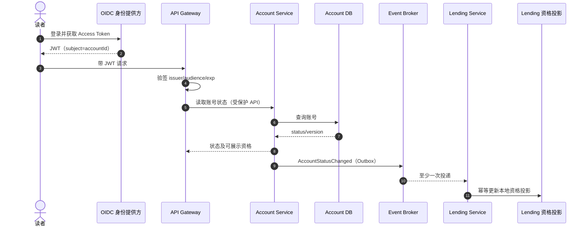

#### 1. 目录搜索、分类筛选与分页

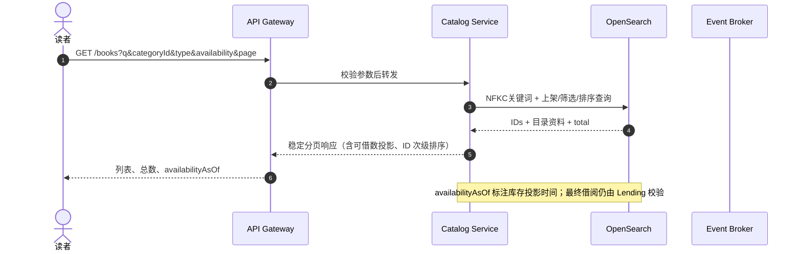

分类列表 `GET /categories` 同样由 Catalog 查询上架条目分类聚合；不触发 Lending 写操作。可借状态筛选在 OpenSearch 的可用名额投影上完成，先过滤再分页，避免总数和页内容不一致；响应带 `availabilityAsOf`，借阅时仍必须重新验证。

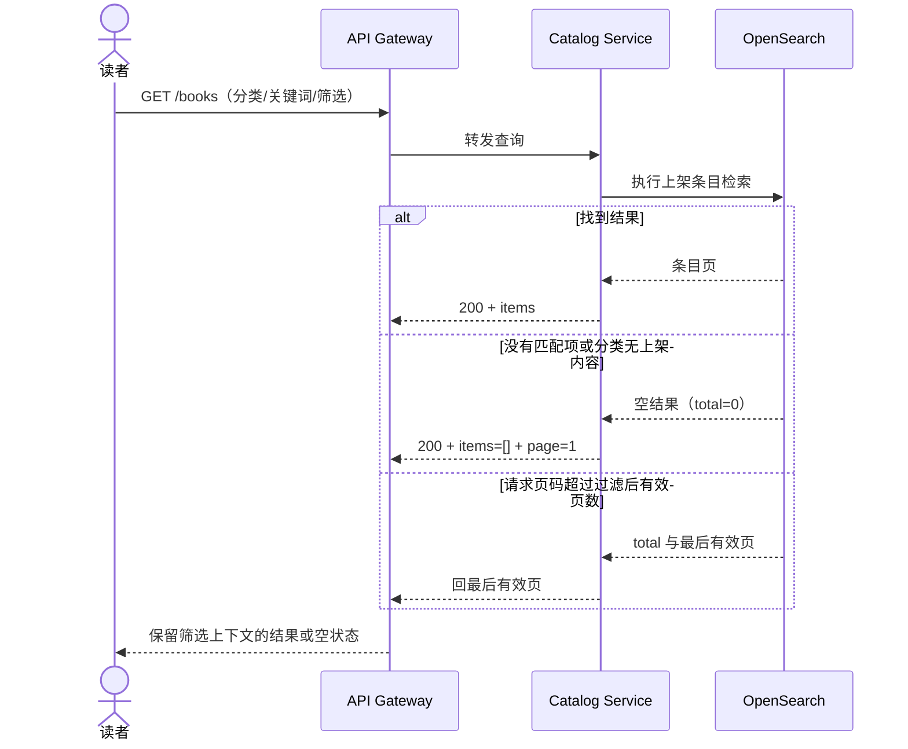

#### 2. 目录详情

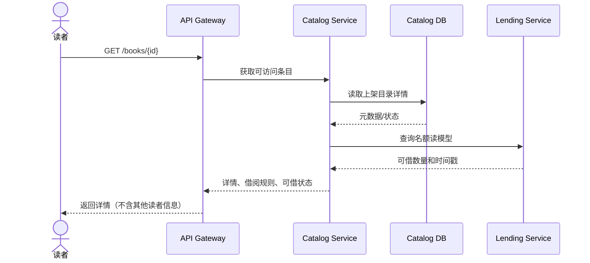

#### 3. 借阅成功、规则拒绝、无库存及未知结果重试

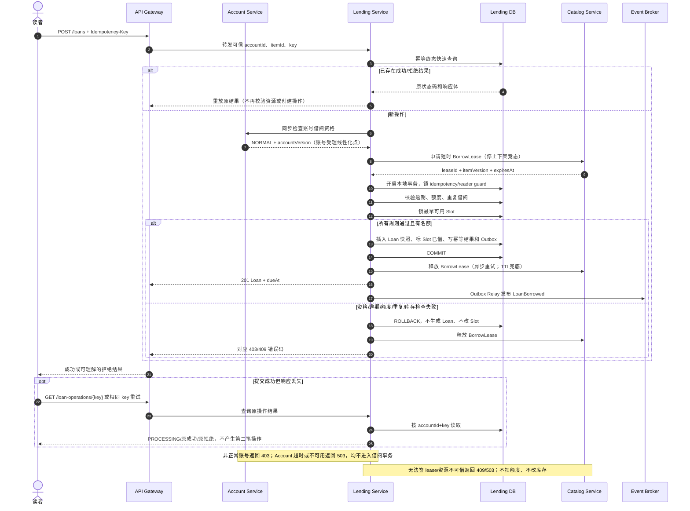

最后名额竞争由 Lending DB 对 item/Slot 的锁串行化；一位读者提交成功，其余请求读取最新状态后以 `BOOK_UNAVAILABLE` 失败。Catalog lease 只协调条目上下架与借阅受理，不预占库存、不改变读者额度；下架进入 `UNLISTING_PENDING` 后不再签发 lease，待已有 lease 完成/过期再发 `CatalogItemUnlisted`。

#### 4. 归还（按时/逾期）与重复提交

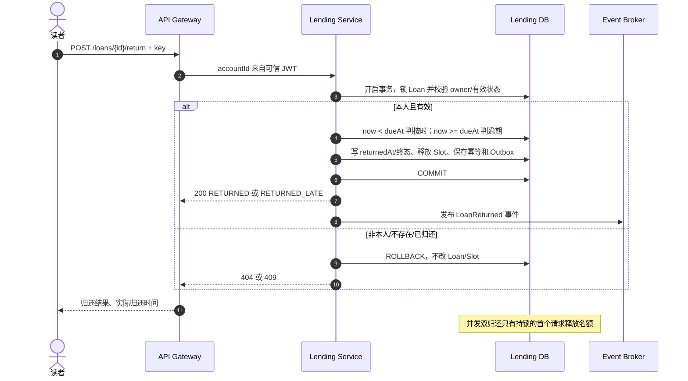

#### 5. 我的借阅列表、逾期动态状态与历史详情

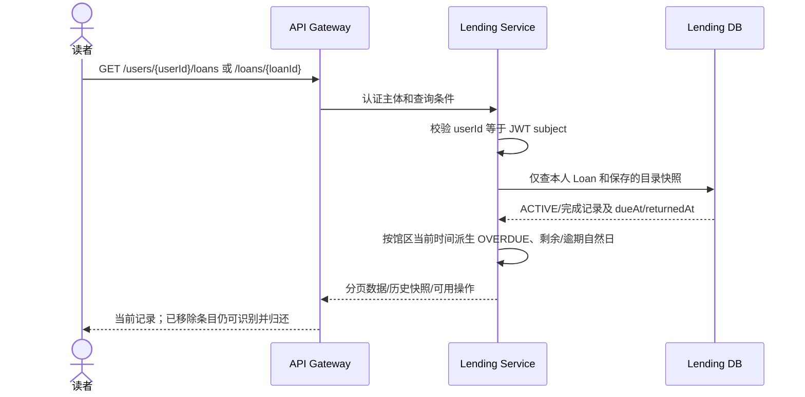

#### 6. 目录下架/移除后的借还与投影传播

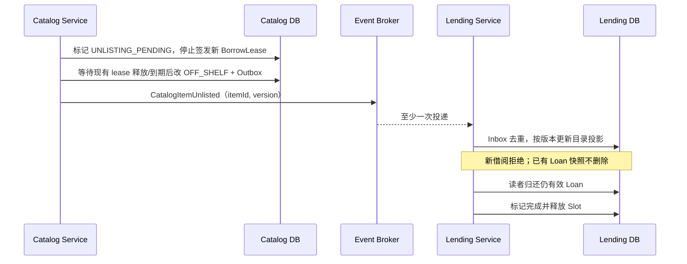

#### 7. 账号冻结/注销与新增借阅限制

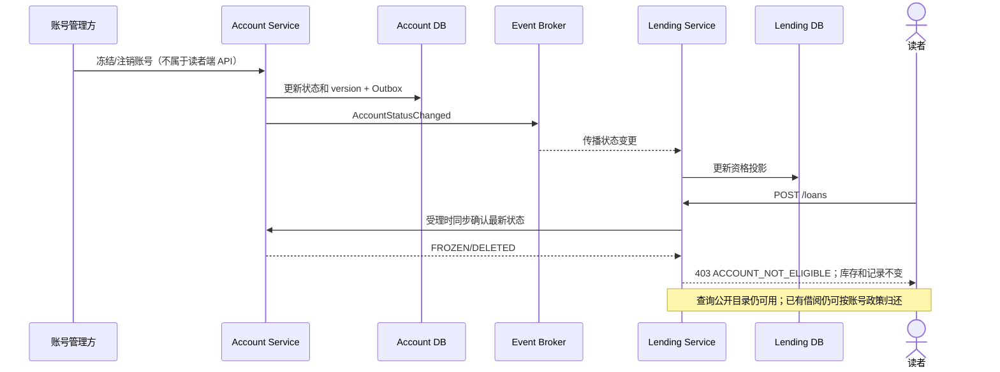

#### 8. 借阅/归还事件更新目录可借数投影

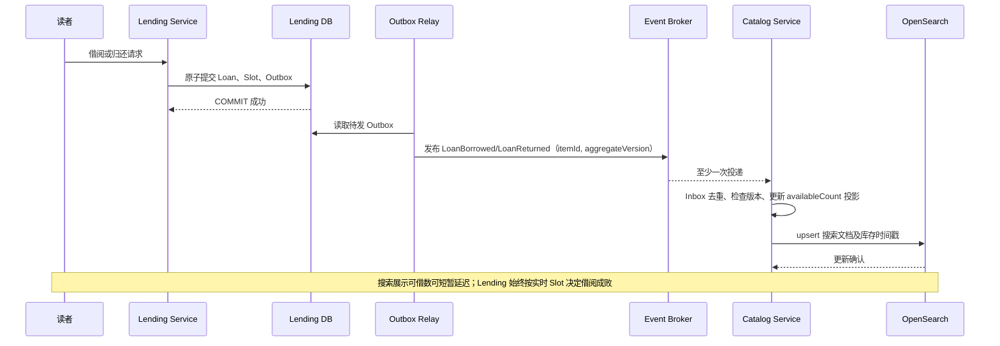

#### 9. 电子书文件导入与读取（阅读访问为后续阶段）

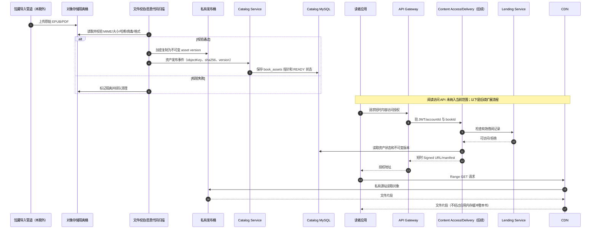

上图覆盖 PRD 的目录/分类筛选、详情、借阅成功和所有前置条件拒绝、最后名额争抢、重复请求/结果未知、按时及逾期归还、双重归还、本人历史、下架/移除、账号冻结等用户场景。无搜索结果、筛选后页码越界和空借阅记录属于同一查询链路的空结果/分页分支，由 Catalog/Lending 返回标准空页，不另做写流程。

## 2. 领域模型设计 (Domain Modelling)

### 核心实体与值对象 (Entities & Value Objects)

| 类型 | 关键属性 | 行为/约束 |
|---|---|---|
| `CatalogItem`（Catalog 聚合根） | `id`、`type`、`title`、`creator`、分类、主题、简介、出版资料、`shelfStatus`、`publishedAt`、`version` | 状态含 ON_SHELF/UNLISTING_PENDING/OFF_SHELF；待下架时不签发新 lease，已持 lease 事务结束后再完成下架。 |
| `LoanSlot`（Lending 内实体） | `id`、`catalogItemId`、`status`（AVAILABLE/LOANED/DISABLED）、`version` | 仅可用名额能分配；借出后关联唯一有效 Loan；释放时恢复可用。条目库存数由可用名额计数得出，不维护易失的重复计数。 |
| `Loan`（聚合根） | `id`、`userId`、`catalogItemId`、`slotId`、状态、`borrowedAt`、`dueAt`、`returnedAt`、借阅资料快照、`version` | `returnAt(now)` 只可从有效状态执行；按 `now < dueAt` 判按时，否则逾期归还。有效状态派生为 `ACTIVE`/`OVERDUE`，完成状态为 `RETURNED`/`RETURNED_LATE`。 |
| `ReaderAccount`（Account 聚合根） | `accountId`、状态、资格等级、`version`、审计字段 | 管理正常/冻结/待核验/注销状态；账号生命周期变更发布事件。凭证由 OIDC 管理。 |
| `ReaderEligibilityProjection`（Lending 投影） | `accountId`、状态、源版本、更新时间 | 加速资格判断；最终借阅仍同步向 Account Service 确认。投影过期时 fail-closed。 |
| `LoanPolicy`（值对象/策略） | 同时借阅上限 5、期限 14 个本地自然日、应还日 23:59:00、馆区 ZoneId | 计算借阅到期时刻；所有参数配置化并验证。 |
| `BookMetadata` / `PeriodicalIssueMetadata`（值对象） | 类型化的 ISBN 或卷期标识、出版资料等 | 目录条目统一可借，但类型差异放在类型化元数据中；期刊按单期作为条目。 |
| `IdempotencyKey`、`PageRequest`、`SearchCriteria` | 请求键、分页排序及检索条件 | 值相等，不承载可变状态。关键词 trim、Unicode 长度校验及规范化规则集中实现。 |

借阅所有权由可信 OIDC `subject/accountId` 标识。账号状态归 Account Service 管理，不在 Lending 重复维护账号主数据。借阅历史保留 `titleSnapshot`、`creatorSnapshot`、`typeSnapshot` 等字段，即使目录条目被下架或永久移除，也能识别并归还。

### 关联关系与聚合边界

- `CatalogItem` 由 Catalog 拥有；Lending 侧以 `catalogItemId` 维护名额投影及多个 `LoanSlot`，不建立跨库外键；一条有效 `Loan` 占用一个 Slot，一个读者可拥有多条 Loan。
- `Loan` 保存 `catalogItemId`、`slotId` 和历史快照，不将整个目录聚合加载进借阅事务。跨服务数据关联依赖稳定 ID 与事件版本。
- 跨聚合约束（读者有效数、无逾期、同条目无有效 Loan、名额可用）均在 Lending 服务本地事务内验证并借助唯一约束/锁保证；Catalog 元数据只通过事件投影同步。
- 有效借阅定义为 `returned_at IS NULL`；是否逾期在读时按馆区当前时刻派生，不依赖定时任务改写状态。

### 状态转移与领域事件 (State & Transitions)

```text
CatalogItem:  ON_SHELF → UNLISTING_PENDING → OFF_SHELF
              OFF_SHELF → ON_SHELF
LoanSlot:     AVAILABLE → LOANED → AVAILABLE
              AVAILABLE ↔ DISABLED（仅馆藏管理上下文；本期不提供 API）
Loan:         ACTIVE --[now >= dueAt，读时派生]--> OVERDUE
              ACTIVE --[return now < dueAt]------> RETURNED
              ACTIVE/OVERDUE --[return now >= dueAt]→ RETURNED_LATE
```

逾期是基于时间的投影而非必须持久化的状态变更；未归还的 Loan 在 `now >= dueAt` 时显示 `OVERDUE`，并阻止新增借阅。业务事件包括 `LoanBorrowed`、`LoanReturned`、`LoanReturnedLate`、`CatalogItemUnlisted`。事件仅在事务提交后对外发布。

应还时间算法：取借阅成功时间在配置时区的本地日期 `D`，应还时刻为 `D + 13 天` 的 `23:59:00`，再用同一 ZoneId 转回 Instant。该实现按本地日历加日，正确覆盖月末、年末和夏令时变更。归还在 `now < dueAt` 时按时，`now >= dueAt` 时逾期。

### 聚合根与业务一致性 (Aggregates & Consistency)

借阅和归还都使用 Lending DB MySQL InnoDB `READ COMMITTED` 本地事务（显式配置隔离级别），并以固定锁顺序降低死锁：先用 `INSERT ... ON DUPLICATE KEY UPDATE` 确保 reader guard 后锁定该行，再锁本地目录资格投影，最后锁 Slot 或 Loan。可用名额采用 `SELECT ... WHERE item_id=? AND status='AVAILABLE' ORDER BY slot_id LIMIT 1 FOR UPDATE`，在 `READ COMMITTED` 下读取当前已提交状态；锁顺序定义业务受理顺序，争用最后名额时，最先取得名额锁并完成全部条件校验的请求为唯一成功者。

借阅流程不在 Lending DB 事务期间调用其他服务：Gateway 验 JWT；Lending 先按 `(accountId,operation,key)` 查询幂等记录，已有终态时直接返回原结果。新操作在打开事务前同步 Account 资格，并向 Catalog 取得短时 `BorrowLease`。Account 正常状态检查响应是账号资格的受理线性化点；之后发生的冻结影响后续请求。Catalog lease 仅在上架且未进入下架流程时签发，包含 item/version/expiry；Catalog 下架先停止发新 lease，待已有短 lease 释放或到期后才完成下架并发事件，避免“检查仍上架后、下架提交前借阅成功”的 TOCTOU 竞态。随后 Lending 在本地事务再次锁定/登记幂等键，锁 reader guard，查逾期/额度/重复项，锁 Slot，插 Loan 快照、改 Slot、保存幂等结果与 Outbox 后提交；提交或回滚后释放 Catalog lease，服务崩溃时由短 TTL 自动释放。若 Account 或 Catalog 不可用/lease 过期则 fail-closed，返回 503/409；所有远程调用均有短超时、熔断和重试预算。资格投影仍用于读模型和快速拒绝，不能替代受理时 Account 校验。最终库存判断完全在 Lending 本地，不发生跨服务借阅数据库事务。

归还事务：以认证 userId 和 loanId 定位并锁定 Loan，确认所有权与有效状态；锁定对应 Slot；同一事务写入 `returnedAt`、终态并将 Slot 释放，保存幂等结果及 Outbox 后提交。事件发布失败由 Outbox Relay 重试，不回滚已提交借还；消费者以 eventId 去重并按聚合版本排序。重复归还不能二次释放。任一本地失败回滚完整事务。

数据库兜底约束：MySQL 通过生成列 `active_account_id`/`active_slot_id` 的唯一索引防止重复有效借阅和名额多重占用（定义见存储方案）；检查约束保证 `returned_at` 与终态一致。借阅 guard 串行化同一读者的额度/逾期检查；目录与 Slot 锁解决跨读者最后名额竞争。乐观 `version` 用于投影更新，借还核心路径采用行锁。禁止以 Saga 补偿替代借还核心原子事务；跨服务只对非核心派生数据（搜索可借投影、分析、通知）采用可重试最终一致流程。

## 3. API 接口设计 (API Specification)

### 通用规范

- Base Path：`/api/v1`；JSON UTF-8；时间均为 RFC 3339 带偏移量，响应明确标注馆区时区。
- 需登录接口从 Bearer Token 认证上下文解析当前读者。`POST` 借阅/归还要求 `Idempotency-Key`（UUID，建议客户端为一次用户操作生成并在未知结果重试时复用）。同一键同一用户/路由/请求体返回原结果；同键不同请求体返回冲突。另有数据库业务唯一约束兜底。
- 成功响应统一为 `code/message/data/timestamp/traceId`；列表 `data` 为 `{items,page,pageSize,total,sort}`。错误统一为 `code/message/details/timestamp/traceId`，不得泄露其他读者资料或内部堆栈。
- 页码从 1 开始；默认 `pageSize=20`、最大 100。超范围页码回到最后有效页，无结果时回第 1 页。排序仅允许白名单字段；服务端追加 ID 次级排序。
- 目录检索：`q` 最多 100 Unicode 字符，首尾空白去除，纯空白视为空；大小写与常见全/半角差异归一化后，对标题/作者或主编/主题做完整输入子串匹配，不做分词。筛选条件交集。默认 `publishedAt desc,title asc,id asc`；可选 `title asc|desc`、`publishedAt desc`。
- 借阅记录列表按 `status=ACTIVE|OVERDUE|COMPLETED` 筛选；有效记录默认 `dueAt asc,id asc`，完成记录 `returnedAt desc,id asc`。

API 分成读者公开 API、服务间内部 API 与事件契约。登录/凭证 API 属 OIDC 提供方，不由本产品重复实现；Account Service 提供业务账号状态能力。

### 0. 查询本人账号与借阅资格（Account Service）

`GET /api/v1/accounts/me`。Header：`Authorization: Bearer …`。仅返回当前主体自己的读者账号摘要，不返回密码、凭证或其他敏感认证资料。

```json
{"code":"OK","message":"success","timestamp":"2026-10-29T10:00:00+08:00","traceId":"tr-acct-1","data":{"accountId":"usr_01","status":"NORMAL","borrowingEligible":true,"eligibilityReasons":[],"activeLoanLimit":5}}
```

状态码：`200`；`401 UNAUTHENTICATED`；`404 ACCOUNT_NOT_FOUND`（Token subject 无业务账号）；`503 DEPENDENCY_UNAVAILABLE`；`500 INTERNAL_ERROR`。冻结/待核验账号仍可读取自己的状态，返回 `200` 且 `borrowingEligible=false`，供 UI 解释限制。

### 服务间账号资格 API（仅内网 mTLS）

`GET /internal/v1/accounts/{accountId}/borrowing-eligibility`。调用方 Lending Service，采用 workload identity/mTLS；Gateway 不对公网开放。无请求体。成功响应：`{"accountId":"usr_01","status":"NORMAL","eligible":true,"accountVersion":18,"evaluatedAt":"2026-10-29T10:00:00Z"}`。`NORMAL` 为 eligible；`FROZEN`、`PENDING_VERIFICATION`、`DELETED` 为不可借。未知账号 `404`，Account 不可用 `503`。禁止将服务间 API 暴露为客户端接口。

### 服务间目录/库存 API（仅内网 mTLS）

- `POST /internal/v1/catalog/availability:batchGet`（Lending 提供）：Catalog 请求示例 `{"itemIds":["bk_01","bk_02"]}`；Lending 响应 `{"items":[{"itemId":"bk_01","availability":"AVAILABLE","availableCount":2,"version":31,"observedAt":"2026-10-29T10:00:00Z"},{"itemId":"bk_02","availability":"NOT_FOUND","availableCount":0,"version":0,"observedAt":"2026-10-29T10:00:00Z"}]}`。每个请求 ID 原序返回一项；不存在项标记 `NOT_FOUND`，正常零库存标记 `UNAVAILABLE`。超过 100 个 ID 返回 `400`。用于详情/读模型补充，不作借阅授权。
- `POST /internal/v1/catalog-items/{itemId}/borrow-leases`（Catalog 提供）：Lending 用 mTLS 申请短租约，要求 `Idempotency-Key`（复用 Lending operation key），无请求体；仅 `ON_SHELF` 签发。响应 `{"leaseId":"lease_01","itemId":"bk_01","catalogVersion":42,"expiresAt":"2026-10-29T10:00:15Z"}`。同键重试返回同一 lease；下架/移除返回 `409 BOOK_UNAVAILABLE`，未知项 `404`，服务超时 `503`。Lease TTL 建议 15 秒；Lending 事务必须有短于 TTL 的硬超时和失效前提交门槛，超时必须回滚，Catalog 延迟释放待下架状态至少一个事务超时宽限期。
- `DELETE /internal/v1/catalog-items/{itemId}/borrow-leases/{leaseId}`（Catalog 提供）：Lending 在提交/回滚后释放，重复释放幂等 `204`；未知/过期 lease 返回 `204`。进程崩溃由 TTL 清理。
- `GET /internal/v1/catalog-items/{itemId}/lending-eligibility`（Catalog 提供，可选只读）：只用于诊断/详情，不作为并发借阅授权；`200` 返回 `shelfStatus` 和 `catalogVersion`，不存在 `404`。
- 两接口均需 mTLS、服务身份 allowlist、短超时、熔断和限流；不接受客户端传入的 `accountId` 作为授权主体。

### 事件契约

所有事件使用 CloudEvents 风格 envelope：`id, source, type, subject, time, dataschema, traceid, aggregateVersion, data`。事件包含 schema 版本，生产方先写本地 Outbox；消费者 Inbox 唯一约束按 `event.id` 去重，按聚合版本丢弃旧事件。核心事件：

| 事件 | 生产方 → 消费方 | 用途 |
|---|---|---|
| `AccountStatusChanged.v1` | Account → Lending | 更新资格投影；状态含 accountId/status/version。 |
| `CatalogItemPublished.v1`、`CatalogItemMetadataChanged.v1`、`CatalogItemUnlisted.v1` | Catalog → Lending、Search Index | 更新借阅目录投影与检索索引；含 itemId、状态、快照字段、version。 |
| `LoanBorrowed.v1`、`LoanReturned.v1`、`LoanReturnedLate.v1` | Lending → Catalog read projection/审计消费者 | 更新可借数、分析或後续通知；不反向改变借阅事务结果。 |

消息键分别使用 `accountId`、`itemId`、`itemId`，保证同一聚合内顺序。消费者必须容忍 at-least-once，处理事件失败指数退避重试，超过阈值进 DLQ 并告警；重放不得重复扣减库存，需以事件版本重算/应用投影。

### 1. 浏览/检索图书列表

`GET /api/v1/books?q={keyword}&categoryId={id}&type=EBOOK|PERIODICAL&availability=AVAILABLE|UNAVAILABLE&page=1&pageSize=20&sort=publishedAt_desc`

Header：`Accept: application/json`。仅返回上架条目。

```http
HTTP/1.1 200 OK
```
```json
{
  "code":"OK","message":"success","timestamp":"2026-10-29T10:00:00+08:00","traceId":"tr-123",
  "data":{"items":[{"id":"bk_01","type":"EBOOK","title":"示例书","creator":"作者甲","category":{"id":"cat_1","name":"文学"},"coverUrl":null,"availableCount":2,"availability":"AVAILABLE","publishedAt":"2026-10-20T09:00:00+08:00"}],"page":1,"pageSize":20,"total":1,"sort":"publishedAt_desc,title_asc,id_asc"}
}
```

状态码：`200`；`400 INVALID_QUERY`（关键词过长、未知筛选/排序或分页格式错误）；`500/503` 搜索依赖不可用。该目录 API 对匿名读者开放。

### 1a. 获取可用分类

目录筛选所需的分类也是读者目录 API 的一部分：`GET /api/v1/categories?page=1&pageSize=100&sort=name_asc`。无需登录（若站点整体要求登录则由 Gateway 统一保护）。仅返回至少有一个上架条目的分类，避免向读者暴露内部分类维护状态。

```json
{"code":"OK","message":"success","timestamp":"2026-10-29T10:00:00+08:00","traceId":"tr-123a","data":{"items":[{"id":"cat_1","name":"文学","itemCount":18}],"page":1,"pageSize":100,"total":1,"sort":"name_asc,id_asc"}}
```

状态码：`200`；`400 INVALID_QUERY`；`500/503` 分类查询依赖不可用。该目录 API 对匿名读者开放。

### 2. 获取图书详情

`GET /api/v1/books/{id}`。公开目录详情不展示借阅者信息；对历史移除条目的详情，只可经本人借阅记录访问，不由该公开路由泄露。

```json
{"code":"OK","message":"success","timestamp":"2026-10-29T10:00:00+08:00","traceId":"tr-124","data":{"id":"bk_01","type":"EBOOK","title":"示例书","creator":"作者甲","category":{"id":"cat_1","name":"文学"},"description":"简介","publisher":"出版社","publicationDate":"2024-05-01","language":"zh-CN","identifier":{"isbn":"9780000000000"},"coverUrl":null,"shelfStatus":"ON_SHELF","availableCount":2,"availability":"AVAILABLE","loanPolicy":{"loanDays":14,"dueTime":"23:59:00","timeZone":"Asia/Shanghai","maxActiveLoans":5,"renewal":"NOT_SUPPORTED"}}}
```

状态码：`200`；`404 BOOK_NOT_FOUND`（不存在、永久移除或不允许访问）；`400 INVALID_ID`；`500 INTERNAL_ERROR`。无库存仍为 `200`，返回 `UNAVAILABLE`；下架公开查询按产品呈现约定返回 `404`，本人历史记录可见的下架标记由借阅记录 API 返回。

### 3. 借阅图书

`POST /api/v1/loans`。Header：`Authorization: Bearer …`、`Content-Type: application/json`、`Idempotency-Key: 6c0c…`。

Request：
```json
{"catalogItemId":"bk_01"}
```

成功（`201 Created`）：
```json
{"code":"OK","message":"借阅成功","timestamp":"2026-10-29T10:00:00+08:00","traceId":"tr-125","data":{"id":"loan_01","catalogItemId":"bk_01","title":"示例书","creator":"作者甲","type":"EBOOK","borrowedAt":"2026-10-29T10:00:00+08:00","dueAt":"2026-11-11T23:59:00+08:00","status":"ACTIVE","activeLoanCount":1,"maxActiveLoans":5}}
```

状态码：`201` 首次成功；同幂等键重放可返回原 `201`（带 `Idempotent-Replay: true`）；`400 INVALID_REQUEST`；`401 UNAUTHENTICATED`；`403 ACCOUNT_NOT_ELIGIBLE`；`404 BOOK_NOT_FOUND`；`409 OVERDUE_LOANS_EXIST`、`LOAN_LIMIT_EXCEEDED`、`DUPLICATE_ACTIVE_LOAN`、`BOOK_UNAVAILABLE`、`CATALOG_LEASE_EXPIRED`、`IDEMPOTENCY_KEY_REUSED`；`503 DEPENDENCY_UNAVAILABLE`；`500 INTERNAL_ERROR`。全篇采用同一映射，不使用 422。若事务提交成功但响应丢失，客户端以相同 key 重试取得同一响应。

### 4. 归还

`POST /api/v1/loans/{id}/return`。Header 与借阅相同；Request body 可省略（`{}`）。

成功（`200 OK`）：
```json
{"code":"OK","message":"归还成功","timestamp":"2026-11-12T00:01:00+08:00","traceId":"tr-126","data":{"id":"loan_01","status":"RETURNED_LATE","returnedAt":"2026-11-12T00:01:00+08:00","catalogItemId":"bk_01","availableCount":3,"activeLoanCount":0}}
```

状态码：`200`；`401` 未登录；`404 LOAN_NOT_FOUND`（不存在或非本人记录统一隐藏以避免探测）；`409 LOAN_ALREADY_RETURNED`、`LOAN_NOT_RETURNABLE`、`IDEMPOTENCY_KEY_REUSED`；`500`。同 key 重放返回第一次归还结果；不同 key 再归还已完成记录返回 `409`，库存不再增加。

### 5. 查询个人借阅记录

`GET /api/v1/users/{userId}/loans?status=ACTIVE&page=1&pageSize=20&sort=dueAt_asc`。`userId` 必须与认证主体一致，否则返回 `404`，避免泄露用户存在性。支持 `ACTIVE`、`OVERDUE`、`COMPLETED`，未传状态时返回全部并按分组字段展示。

```json
{"code":"OK","message":"success","timestamp":"2026-10-29T10:00:00+08:00","traceId":"tr-127","data":{"items":[{"id":"loan_01","catalogItemId":"bk_01","title":"示例书","creator":"作者甲","type":"EBOOK","catalogStatus":"ON_SHELF","borrowedAt":"2026-10-29T10:00:00+08:00","dueAt":"2026-11-11T23:59:00+08:00","returnedAt":null,"status":"ACTIVE","timeRemaining":{"kind":"DAYS_REMAINING","days":13},"actions":["RETURN"]}],"page":1,"pageSize":20,"total":1,"sort":"dueAt_asc,id_asc"}}
```

状态码：`200`；`400 INVALID_QUERY`；`401 UNAUTHENTICATED`；`500 INTERNAL_ERROR`。剩余/逾期天数按馆区本地自然日规则计算；不足 24 小时且未到期返回 `kind=IMMINENT`，到期后逾期 0 天显示 `OVERDUE_DAYS, days=0`。

### 6. 查询本人单条借阅记录

`GET /api/v1/loans/{loanId}`。仅本人可查；用于历史详情和未知操作后核对最终借阅状态。即使目录条目下架或永久移除，返回借阅时保存的快照，仍有效时包含归还入口。

```json
{"code":"OK","message":"success","timestamp":"2026-10-29T10:00:00+08:00","traceId":"tr-128","data":{"id":"loan_01","catalogItemId":"bk_01","title":"示例书","creator":"作者甲","type":"EBOOK","catalogStatus":"REMOVED","borrowedAt":"2026-10-29T10:00:00+08:00","dueAt":"2026-11-11T23:59:00+08:00","returnedAt":null,"status":"ACTIVE","actions":["RETURN"]}}
```

状态码：`200`；`401 UNAUTHENTICATED`；`404 LOAN_NOT_FOUND`（不存在或非本人）；`500 INTERNAL_ERROR`。

### 7. 查询借阅操作结果（网络结果未知时）

`GET /api/v1/loan-operations/{idempotencyKey}`。仅限提交该操作的认证用户；key 是客户端 `Idempotency-Key`。重试 POST 时优先复用原 key；该 GET 供客户端轮询 pending 或找回已完成的原响应，不产生业务副作用。

```json
{"code":"OK","message":"success","timestamp":"2026-10-29T10:00:01+08:00","traceId":"tr-129","data":{"operationId":"6c0c…","state":"COMPLETED","httpStatus":201,"result":{"id":"loan_01","status":"ACTIVE"}}}
```

状态码：`200`（`state=PROCESSING|COMPLETED|REJECTED`）；`401 UNAUTHENTICATED`；`404 OPERATION_NOT_FOUND`；`400 INVALID_IDEMPOTENCY_KEY`；`500 INTERNAL_ERROR`。该查询是对 PRD 网络中断后查询同一操作结果的服务端支持。

### 本期对外 API 与服务间 API 总清单

| 服务 | Method / Path | 认证 | 用途 |
|---|---|---|---|
| Account | `GET /api/v1/accounts/me` | 必须 | 查看本人账号状态及借阅资格 |
| Catalog | `GET /api/v1/categories` | 可匿名 | 获取可用分类筛选项 |
| Catalog | `GET /api/v1/books` | 可匿名 | 检索、过滤、分页目录 |
| Catalog | `GET /api/v1/books/{id}` | 可匿名 | 查询当前可访问条目详情 |
| Lending | `POST /api/v1/loans` | 必须 | 借阅，要求 Idempotency-Key |
| Lending | `POST /api/v1/loans/{id}/return` | 必须 | 归还，要求 Idempotency-Key |
| Lending | `GET /api/v1/users/{userId}/loans` | 必须且本人 | 分页查询本人借阅列表 |
| Lending | `GET /api/v1/loans/{id}` | 必须且本人 | 查询本人单条记录/历史快照 |
| Lending | `GET /api/v1/loan-operations/{idempotencyKey}` | 必须且本人 | 查询操作是否完成及原结果 |
| Account（内部） | `GET /internal/v1/accounts/{accountId}/borrowing-eligibility` | mTLS 服务身份 | Lending 受理借阅时确认实时资格 |
| Lending（内部） | `POST /internal/v1/catalog/availability:batchGet` | mTLS 服务身份 | Catalog 批量读取可用名额读模型 |
| Catalog（内部） | `GET /internal/v1/catalog-items/{itemId}/lending-eligibility` | mTLS 服务身份 | Lending 借阅前核验最新上架状态 |
| Catalog（内部） | `POST /internal/v1/catalog-items/{itemId}/borrow-leases` | mTLS 服务身份 | 原子取得短时上架资格 lease，防止下架竞态 |
| Catalog（内部） | `DELETE /internal/v1/catalog-items/{itemId}/borrow-leases/{leaseId}` | mTLS 服务身份 | Lending 完成借阅后释放 lease |

本期不提供用户注册/登录、密码/MFA、馆藏增删改/上下架/名额管理、续借、预约、罚金、通知、阅读内容访问 API。账号创建及状态变更由受信任的账号管理渠道处理；账号查询与借阅资格由 Account Service 提供。健康检查和指标端点仅集群内部使用，不属于读者业务 API：`/actuator/health/liveness`、`/actuator/health/readiness`、`/actuator/prometheus`，经网络策略限制访问。

### 每个接口的测试用例（输入/输出契约）

#### 测试固定条件与通用断言

- 集成测试固定 Clock：`2026-10-29T10:00:00+08:00`，馆区时区 `Asia/Shanghai`。成功借阅默认 `borrowedAt=2026-10-29T10:00:00+08:00`、`dueAt=2026-11-11T23:59:00+08:00`。
- `U1` 为正常读者、当前 0 项有效借阅、无逾期；`U2` 为冻结读者；`U3` 有 1 项逾期；`U4` 已有 5 项有效借阅。`B1` 上架且有 1 个名额；`B0` 上架但无名额；`BO` 下架；`BR` 永久移除。所有 IDs 在自动化测试中用固定 UUIDv7。
- 认证用户测试使用 `Authorization: Bearer <valid-token>`；借还测试另带唯一 `Idempotency-Key`。错误统一断言 `{code,message,details,timestamp,traceId}`，并验证无数据泄漏。
- 下列表格中的输出为必须断言的 HTTP 状态码、`code` 或关键 JSON 字段；随机生成的 loanId/traceId 用 schema 和非空断言，不比较固定值。

#### A. `GET /api/v1/accounts/me`

| 场景 | 输入 | 预期输出 |
|---|---|---|
| 正常账号 | 有效 JWT subject=U1 | `200`，`data={accountId:U1,status:NORMAL,borrowingEligible:true,activeLoanLimit:5}` |
| 冻结/待核验/注销 | subject 分别对应三种账号状态 | `200`，状态准确，`borrowingEligible=false`，有可展示限制原因；不得返回凭证字段 |
| 无 Token/Token 过期或签名错误 | 缺失/无效 Bearer | `401 UNAUTHENTICATED` |
| Token 无业务账号 | subject 无 Account 记录 | `404 ACCOUNT_NOT_FOUND` |
| Account DB 不可用 | 有效 Token，注入连接失败 | `503 DEPENDENCY_UNAVAILABLE`，不返回内部异常 |

#### B. `GET /internal/v1/accounts/{accountId}/borrowing-eligibility`

| 场景 | 输入 | 预期输出 |
|---|---|---|
| 正常 | mTLS Lending 身份，U1 | `200 {accountId:U1,status:NORMAL,eligible:true,accountVersion:n,evaluatedAt:...}` |
| 不可借账号 | U2/U3 等状态账号 | `200 eligible=false` 且状态对应，不把资格拒绝误报成系统故障 |
| 不存在 | 未登记 accountId | `404 ACCOUNT_NOT_FOUND` |
| 非可信调用方 | 无 mTLS/错误 workload identity | `401/403 SERVICE_UNAUTHENTICATED`，不查询账号 |
| DB 超时/熔断 | 注入 Account DB/服务故障 | `503 DEPENDENCY_UNAVAILABLE`，Lending 不可 fail-open |

#### C. `POST /internal/v1/catalog/availability:batchGet`

| 场景 | 输入 | 预期输出 |
|---|---|---|
| 多条目查询 | mTLS Catalog；`{"itemIds":[B1,B0]}` | `200`，items 对每个 ID 返回 `availableCount`、projection `version`、`observedAt`；B1=1、B0=0 |
| 空数组 | `{"itemIds":[]}` | `200 {items:[]}`，不访问 Lending DB |
| 未知/已移除 ID | 含 BR | `200`；对应 `availableCount:0,availability:NOT_FOUND`，不泄露 Loan 信息 |
| 超过 100 个 ID/格式错误 | 101 项或非法 ID | `400 INVALID_REQUEST`，无部分响应 |
| 无 mTLS/越权服务身份 | 错误 workload identity | `401/403 SERVICE_UNAUTHENTICATED` |
| Lending DB 故障 | 注入超时 | `503 DEPENDENCY_UNAVAILABLE`，Catalog 不将缓存伪装成实时数据；可返回有时效标记的既有投影仅在契约允许时 |

#### D. `GET /internal/v1/catalog-items/{itemId}/lending-eligibility`

| 场景 | 输入 | 预期输出 |
|---|---|---|
| 上架 | mTLS Lending，B1 | `200 {itemId:B1,shelfStatus:ON_SHELF,catalogVersion:n}` |
| 待下架/下架 | item 状态 `UNLISTING_PENDING`/`OFF_SHELF` | `200` 且精确返回状态；不能当作可借授权 |
| 永久移除/未知 | BR/随机 ID | `404 BOOK_NOT_FOUND` |
| 非服务身份/超时 | 无 mTLS 或 Catalog DB 不可用 | `401/403` 或 `503`；Lending fail-closed |

#### E. `POST /internal/v1/catalog-items/{itemId}/borrow-leases`

输入：mTLS Lending 身份、`Idempotency-Key: <borrow-operation-key>`、空 body。

| 场景 | 预期输出 |
|---|---|
| 上架可申请 | `201 {leaseId,itemId:B1,catalogVersion,expiresAt}`，expiresAt 在配置 TTL 内 |
| 相同 key 重试 | 返回原 `201` 和同一 leaseId，不能生成第二个 active lease |
| 不同 key 并发申请 | 每个请求各自取得 lease；不修改名额或库存 |
| 待下架/下架 | `409 BOOK_UNAVAILABLE`，不建 lease |
| 不存在/移除 | `404 BOOK_NOT_FOUND` |
| DB/服务故障或 mTLS 失败 | `503 DEPENDENCY_UNAVAILABLE` 或 `401/403`；不允许绕过 lease 借阅 |
| 下架与申请竞态 | 串行化结果只能是先拿到 lease 后下架等待，或先进入待下架后拒绝申请；不得在下架完成后返回新 lease |

#### F. `DELETE /internal/v1/catalog-items/{itemId}/borrow-leases/{leaseId}`

| 场景 | 输入 | 预期输出 |
|---|---|---|
| 正常释放 | 有效 Lending mTLS、有效 lease | `204`；数据库状态 RELEASED，随后待下架流程可继续 |
| 重复释放 | 同一 lease 再 DELETE | `204`，幂等，无负计数/重复事件 |
| 已过期/不存在 lease | 有效服务身份 | `204`，不改变其他 lease |
| lease 与 item 不匹配/无权服务身份 | 路径篡改/无 mTLS | `404` 或 `401/403`，不能释放他人 lease |
| Catalog DB 故障 | 注入失败 | `503`；Lending 重试，TTL 最终回收 |

#### G. `GET /api/v1/categories`

| 场景 | 输入 | 预期输出 |
|---|---|---|
| 有上架分类 | 默认参数 | `200`，仅返回至少有一条上架内容的分类，页大小≤100，稳定 `name,id` 排序 |
| 空馆藏/分类无上架条目 | 无可见分类 | `200 {items:[],page:1,total:0}` |
| 分页/排序合法边界 | `page=2&pageSize=100&sort=name_asc` | `200`，分页合法；无结果越界回第一页 |
| 非法分页/排序 | `page=0`、未知 sort 或 pageSize>100 | `400 INVALID_QUERY` |
| 匿名访问 | 无 Token | `200`；目录浏览是公开接口 |
| OpenSearch/MySQL 不可用 | 注入依赖故障 | `500/503` 标准系统错误，不伪造分类结果 |

#### H. `GET /api/v1/books`

| 场景 | 输入 | 预期输出 |
|---|---|---|
| 默认浏览 | 无 query | `200`，只含 ON_SHELF，按 `publishedAt desc,title asc,id asc`；每页默认 20 |
| 每类字段检索 | `q=作者甲`、标题词、主题词分别请求 | `200`，完整输入做包含匹配；大小写/常见全半角统一；首尾 trim |
| 空白关键词 | `q=%20%20` | 等同无关键词，保留其他筛选 |
| 长度限制 | 100 Unicode 字符/101 字符 | 100 字符正常查询；101 返回 `400 INVALID_QUERY`，不截断、不放宽查询 |
| 多筛选交集 | categoryId + EBOOK + AVAILABLE | 所有结果同时满足三条件；库存投影先过滤后分页并带 `availabilityAsOf` |
| 暂不可借 | `availability=UNAVAILABLE` | 仅返回投影名额=0 条目；列表状态为 UNAVAILABLE |
| 下架/零结果 | 搜索仅匹配 BO 或不存在关键词 | 下架不出现；空集 `200 items=[] total=0 page=1`，筛选上下文不变 |
| 稳定排序/边界页 | 上架时间、标题相同；筛选后请求过大页码 | ID 作为最终并列排序；回最后有效页，空集回第 1 页 |
| 无 Token/非法参数 | 匿名；非法 type/sort/page | 匿名 `200`；非法参数 `400 INVALID_QUERY` |
| 搜索服务故障 | OpenSearch 超时/重建切换 | `503/500`，不将下架/全量数据作为降级结果；Trace ID 可关联 |

#### I. `GET /api/v1/books/{id}`

| 场景 | 输入 | 预期输出 |
|---|---|---|
| 上架有库存/无库存 | B1/B0 | `200`；返回完整可用元数据、`availableCount`、AVAILABLE/UNAVAILABLE、借阅规则 |
| 下架 | BO | 按当前公开详情约定 `404 BOOK_NOT_FOUND`；不得显示新借入口 |
| 移除/随机 ID | BR/不存在 | `404 BOOK_NOT_FOUND`；不泄露其他用户历史 |
| 元数据字段缺失 | 标题存在但 publisher/cover 等为空 | `200`，缺失字段省略或 null，不能伪造默认出版信息 |
| 电子书/期刊 | ISBN 与 issue identifier 分别存在 | `200`，type 和对应 identifier 正确；期刊按单期显示 |
| 下游故障 | Catalog DB 或可借数依赖不可用 | `503`；不得把旧库存显示为确定可借（允许带时间戳的投影须遵循 API 契约） |

#### J. `POST /api/v1/loans`

输入：Bearer JWT、唯一 `Idempotency-Key`、`{"catalogItemId":"B1"}`。

| 场景 | 预期输出与数据断言 |
|---|---|
| 全部校验通过 | `201`，返回唯一 loanId、B1 快照、借阅时间、应还日 `2026-11-11T23:59:00+08:00`、ACTIVE；MySQL Loan 插入、一个 Slot→LOANED，outbox 一条 |
| 账号冻结/未核验/注销 | `403 ACCOUNT_NOT_ELIGIBLE`；无 Loan、Slot、额度变更；lease 已释放 |
| 有逾期项 | U3 请求 → `409 OVERDUE_LOANS_EXIST`；库存和记录不变 |
| 达 5 项额度 | U4 请求 → `409 LOAN_LIMIT_EXCEEDED`；库存和记录不变 |
| 已借同条目 | U1 已有 B1 有效 Loan → `409 DUPLICATE_ACTIVE_LOAN`；无新增记录 |
| 条目下架/移除 | lease 被拒绝 → `409 BOOK_UNAVAILABLE` 或 `404 BOOK_NOT_FOUND`；无 DB 写副作用 |
| 零库存/最后名额被抢 | B0 或并发失败者 → `409 BOOK_UNAVAILABLE`；无 Loan/额度/Slot 变化 |
| Account/Catalog 超时 | `503 DEPENDENCY_UNAVAILABLE`；fail-closed，lease 若已取得必须释放/TTL 回收 |
| 缺少/格式错误 body、缺少 Idempotency-Key、关键词外字段 | `400 INVALID_REQUEST`；无远程 lease或事务写 |
| 缺失/无效 Token | `401 UNAUTHENTICATED`；不触达业务数据库 |
| 同 key 同 body 重试 | 重放原 HTTP `201` 和相同 loanId；只一条 Loan/一条有效 Slot 占用 |
| 同 key 不同 body | `409 IDEMPOTENCY_KEY_REUSED`；不修改第一次结果 |
| 不同 key 重复借同一本 | `409 DUPLICATE_ACTIVE_LOAN`；部分唯一索引兜底 |
| 事务中注入 SQL/提交失败 | `500/503`；Loan、Slot、幂等结果、Outbox 全回滚，lease 释放 |
| 两人竞争最后名额 N 路 | 并发集成测试：恰 1 个 `201`，N-1 个 `409 BOOK_UNAVAILABLE`；仅一条有效 Loan，Slot 不超借 |
| 同一用户并发借不同条目 | 超过上限的请求串行判定；最终 active count≤5 |

#### K. `POST /api/v1/loans/{id}/return`

输入：Bearer JWT、`Idempotency-Key`、空 JSON `{}`。

| 场景 | 预期输出与数据断言 |
|---|---|
| 到期前归还 | `200 status=RETURNED,returnedAt=now`；Loan 完成、Slot 仅释放一次 |
| `now == dueAt` 或之后 | `200 status=RETURNED_LATE`；保留真实 returnedAt，逾期历史可见 |
| 逾期有效 Loan 归还 | `200 RETURNED_LATE`；若无其他逾期，新增借阅限制解除 |
| 非本人/不存在 | `404 LOAN_NOT_FOUND`；不泄露记录是否存在，不改 Loan/Slot |
| 已归还 | 新 key → `409 LOAN_ALREADY_RETURNED`；不重复增加库存 |
| 下架/永久移除的条目仍持有有效 Loan | `200` 成功归还；使用 Loan.slot_id 释放名额，Catalog 状态不被改回上架 |
| 重复同 key | 重放原 `200` 和原 returnedAt；Slot 不重复释放 |
| 其他逾期项仍在 | 当前还书成功但列表仍有 OVERDUE；借阅继续被限制 |
| 缺 Token/无 Idempotency-Key/非法 loanId | 分别 `401`/`400`；无状态变化 |
| DB 在写 Loan 后释放 Slot 前失败 | `500/503`；整个 InnoDB 事务回滚，记录仍有效且 Slot 仍 LOANED |
| 并发双归还 | 同时提交仅一个状态变更与名额释放；另一请求重放/409，无重复库存 |

#### L. `GET /api/v1/users/{userId}/loans`

| 场景 | 输入 | 预期输出 |
|---|---|---|
| 进行中 | `status=ACTIVE` | `200`，仅未到期有效项，dueAt 升序 + ID；含 RETURN action |
| 已逾期 | `status=OVERDUE` | `200`，now≥dueAt 且未归还项；刚到期 days=0，时间采用馆区时区 |
| 已完成 | `status=COMPLETED` | `200`，RETURNED/RETURNED_LATE，returnedAt 倒序，不含 RETURN action |
| 全部/空列表 | 不传 status / 用户从未借阅 | `200`，按状态分组字段或空 `items=[] total=0`，不得报 404 |
| 时间和并列边界 | dueAt==now、同 dueAt/returnedAt 多记录 | 归逾期；按 loanId 稳定排序；分页无重无漏 |
| 本人历史条目已下架/移除 | 对应记录存在 | `200`，从快照返回 title/creator/type，并标识 `catalogStatus` |
| path userId 伪造/他人 ID | userId≠JWT subject | `404`，不泄露他人记录 |
| 未登录/非法 status/page/sort | 缺 token 或非法 query | `401` 或 `400 INVALID_QUERY` |
| 查询依赖故障 | Lending DB 不可用 | `503/500`，不返回其他用户缓存 |

#### M. `GET /api/v1/loans/{loanId}`

| 场景 | 输入 | 预期输出 |
|---|---|---|
| 本人有效未逾期/逾期 | U1+loanId | `200`，快照、dueAt、动态状态 ACTIVE/OVERDUE、RETURN action |
| 本人已完成 | U1+完成 loanId | `200`，returnedAt、RETURNED/RETURNED_LATE，只读 |
| Catalog 删除或下架 | Loan 快照仍存在 | `200`，仍展示历史识别字段和归还能力（若有效） |
| 他人/不存在 | U2 查询 U1 loanId 或随机 ID | `404 LOAN_NOT_FOUND`，响应一致 |
| 未登录/数据库故障 | 缺 token/注入故障 | `401` 或 `503/500` |

#### N. `GET /api/v1/loan-operations/{idempotencyKey}`

| 场景 | 输入 | 预期输出 |
|---|---|---|
| 操作处理中 | 同一用户、key 已登记处理中 | `200 state=PROCESSING`，不返回他人数据 |
| 成功/拒绝完成 | key 已有终态 | `200 state=COMPLETED|REJECTED`，httpStatus 和 result 与原 POST 完全一致 |
| 未知 key/过期清理后 | 当前用户查询不存在 key | `404 OPERATION_NOT_FOUND` |
| 他人 key | 不同用户相同 key | `404`，不可枚举操作 |
| 非法 key/缺 Token/DB 故障 | 格式错/无认证/故障 | `400 INVALID_IDEMPOTENCY_KEY`、`401`、`503/500` |

#### O. 跨服务事件契约测试（非 HTTP API）

`AccountStatusChanged`、`CatalogItemPublished/MetadataChanged/Unlisted`、`LoanBorrowed/Returned/ReturnedLate` 均需测试：合法 schema 版本可消费；缺字段/未知必填枚举进 DLQ；相同 eventId 二次投递只应用一次；同 aggregateVersion 重复无变化；旧版本不得覆盖新状态；版本缺口触发重放/告警；消费者处理失败事务回滚 Inbox 与投影；Outbox 业务提交原子性；对象资产事件不会泄露 object key 给未授权消费者。

#### P. 运维端点测试（仅集群内网）

| 接口 | 输入/场景 | 预期输出 |
|---|---|---|
| `GET /actuator/health/liveness` | 进程存活，即使下游 DB 暂时断开 | `200 UP`；不因下游短暂故障触发容器重启风暴 |
| `GET /actuator/health/readiness` | MySQL/Kafka 等必要依赖可用/不可用 | 可用 `200 UP`；不可接流量时 `503 DOWN` 并列内部组件状态，不泄露凭证/主机秘密 |
| `GET /actuator/prometheus` | 内网 Prometheus 抓取 | `200` 合法 exposition；包含 API/DB/锁等待/Outbox lag 指标，不包含 userId、Token、完整 object key 等高基数/敏感标签 |
| 任意 actuator 从公网或未授权网络访问 | 无内网身份/错误网络策略 | 网络层拒绝或 `401/403`；端点不暴露给读者 |

## 4. 程序码结构与组织规范 (Code Organization)

```text
services/
  api-gateway/             # 路由、认证、限流、OpenAPI 聚合，不放业务规则
  account-service/         # 账号状态、资格查询、账号事件
    api/ application/ domain/ infrastructure/ db/migration/
  catalog-service/
    api/                   # CatalogController、请求/响应 DTO
    application/           # BrowseCatalog、GetCatalogItem、查询端口
    domain/                # CatalogItem、搜索规则、Repository 接口
    infrastructure/        # SQL Mapper、Repository 实现
    db/migration/          # Catalog DB migrations
  lending-service/
    api/                   # LoanController、Loan DTO
    application/           # BorrowLoan、ReturnLoan、ListReaderLoans
    domain/                # Loan、LoanSlot、LoanPolicy、Repository 接口、事件
    infrastructure/        # Lending DB、锁、幂等、Outbox/Inbox、Broker adapter
    db/migration/          # Lending DB migrations
  oidc-adapter/            # JWT/OIDC Resource Server 配置，不存凭证
  account-client/          # Lending 调用 Account API 的 mTLS 客户端与契约
  contracts/               # OpenAPI、事件 schema、兼容性检查
  platform/                # 本地开发 Compose、部署 chart、observability 配置
```

每个 service 的内层结构：

```text
src/main/java/.../{api,application,domain,infrastructure,config,error}
src/main/resources/db/migration/
src/test/java/.../{domain,application,adapter,contract,e2e}
```

命名按业务能力而非技术层横向切分；Domain 包不引用 Spring/JPA 类型。Controller DTO 与领域对象分离，映射由 Mapper 负责。Repository 接口属于 Domain/Application 内侧，SQL 实现属于 Infrastructure。所有数据库迁移版本化，禁止生产环境自动建表。

设计模式：Repository 封装聚合持久化；Strategy/Policy 为可替换的借阅资格与期限规则；Factory 只用于构造通过不变量校验的 Loan；Adapter 隔离身份提供方、数据库及未来通知渠道；Specification/查询对象封装目录检索组合；Outbox 可靠发布提交后的领域事件。避免为简单 CRUD 引入无必要抽象。

## 5. 全局错误处理与异常规范 (Error Handling)

### 异常分级与统一响应

- **领域异常**：规则被拒绝，如额度已满、逾期未还、名额不可用；携带稳定 `ErrorCode`，不包含数据库细节。
- **请求校验异常**：字段缺失、格式错误、关键词超过 100 字符、非法分页/排序；返回字段级 details。
- **系统异常**：数据库、依赖超时或未预期错误；统一映射 `INTERNAL_ERROR`，返回通用信息，服务端记录堆栈和 traceId。
- Spring `@ControllerAdvice` 集中映射；对外不返回 SQL、类名、Token、个人敏感资料。

| 错误码 | HTTP | 含义 |
|---|---:|---|
| `INVALID_REQUEST` / `INVALID_QUERY` | 400 | 请求格式、参数或关键词无效 |
| `UNAUTHENTICATED` | 401 | 缺少/无效登录凭证 |
| `ACCOUNT_NOT_ELIGIBLE` | 403 | 账号冻结、注销或未核验 |
| `BOOK_NOT_FOUND` / `LOAN_NOT_FOUND` | 404 | 资源/记录不存在；非本人记录隐藏为 404 |
| `LOAN_LIMIT_EXCEEDED` | 409 | 已持有 5 项有效借阅 |
| `OVERDUE_LOANS_EXIST` | 409 | 存在未归还逾期项 |
| `DUPLICATE_ACTIVE_LOAN` | 409 | 已有效借阅同一目录条目 |
| `BOOK_UNAVAILABLE` | 409 | 下架或无可用名额/最后名额已被获取 |
| `CATALOG_LEASE_EXPIRED` | 409 | 借阅事务未能在上架资格 lease 的有效窗口内完成，整笔本地事务回滚 |
| `LOAN_ALREADY_RETURNED` / `LOAN_NOT_RETURNABLE` | 409 | 已完成或当前状态不可归还 |
| `IDEMPOTENCY_KEY_REUSED` | 409 | 相同 key 对应不同操作内容 |
| `DEPENDENCY_UNAVAILABLE` | 503 | 账号等依赖服务不可用；禁止在无法确认资格时放行借阅 |
| `INTERNAL_ERROR` | 500 | 未预期服务错误 |

### 事务与失败回滚机制

`BorrowLoan` 和 `ReturnLoan` 各自以一个 `@Transactional` 用例为事务边界。写入借阅记录、名额状态、幂等结果及 Outbox 必须同库同事务提交。任何异常在提交前抛出即整体回滚；不要捕获异常后继续提交，也不要在事务中调用不可回滚的外部副作用。账号资格如来自远程端，须在取得锁后按明确超时读取；失败即 503。若业务要求资格快照与数据库强原子一致，需后续引入账户事件/本地投影并明确一致性 SLA。

幂等表建议主键 `(user_id, route, idempotency_key)`，保存请求摘要、处理中/完成状态、HTTP 状态及响应体；与业务写操作同事务，唯一键冲突时读取已存结果。处理中的请求采用数据库锁等待或明确 `409 REQUEST_IN_PROGRESS`，不能创建第二笔业务操作。

## 6. 可维护性与可扩展性设计 (Maintainability & Extensibility)

### 测试策略 (Testing Strategy)

#### 测试分层与门禁

- **Domain 单元测试**不启动 Spring；固定 Clock 和 ZoneId，边界值穷举。每个规则和状态转换必须有正向、拒绝、边界测试。
- **Application 用例测试**用 fake/mock 端口验证步骤顺序、授权上下文、事务边界、幂等重放、依赖超时和错误映射。
- **Adapter/集成测试**使用 Testcontainers MySQL 8.4、Broker、OpenSearch 验证真实 SQL、生成列唯一约束、锁语义、消息确认/重试和索引投影。不能用 H2 替代并发与锁测试。
- **契约测试**OpenAPI 与事件 schema 做兼容性检查；消费者驱动契约验证 Gateway、Account、Catalog、Lending 之间的版本兼容。
- **端到端/故障测试**在临时环境验证完整用户旅程及服务中断/恢复；发布门禁包含迁移兼容性、SLO smoke test、安全扫描。

#### 业务与边界场景矩阵

| 区域 | 必测场景 |
|---|---|
| 目录搜索 | 默认只上架；标题/作者/主编/主题子串命中；大小写与全半角规范化；首尾空格与纯空白；100 字符边界及 101 字符拒绝（不得截断）；分类/类型/可借状态交集；空结果；筛选后页码越界归最后页；相同上架时间标题及 ID 稳定排序；下架立即从结果移除；关键词特殊字符安全转义；索引更新延迟与 `availabilityAsOf`。 |
| 详情 | 上架且有库存、零库存、下架、永久移除、无权访问；可选字段缺失不伪造；电子书 ISBN 与期刊卷期；历史快照可读；不返回其他读者数据。 |
| 借阅规则 | 正常账号成功；冻结/注销/未核验拒绝；恰有 4 项成功、已有 5 项拒绝；存在一项/多项逾期拒绝；无逾期后恢复资格；同条目有效借阅拒绝、归还后可重借；条目下架/移除/零库存拒绝；每一失败均断言 Loan、Slot、额度均无变化。 |
| 借阅时间 | 14 个本地自然日算法；借阅当天算第 1 日；跨月/跨年；闰日；夏令时跳变/重复时刻；应还时刻精确为 23:59:00；不同 JVM 默认时区计算结果相同。 |
| 借阅并发 | 最后一个 Slot 的 N 路并发仅一成功；多 Slot 时成功数不超过 Slot 数；同 user 并发借不同条目不超过上限；同 user 同条目双请求只一条有效 Loan；不同读者可并行；死锁检测与有限重试；请求受理顺序/锁顺序验证；失败请求不排队且无副作用。 |
| 幂等与网络故障 | 同 key 同 payload 重放原状态码/响应；同 key 不同 payload 返回 409；提交后响应丢失后重试不重复借阅；处理中状态查询；幂等记录过期策略；并发相同 key；客户端超时、Gateway 重试与断路器行为。 |
| 归还 | 本人有效记录按时归还；`now == dueAt` 属逾期归还；逾期记录可归还；非本人/不存在统一 404；已归还拒绝；下架/移除条目仍可归还；同时双归还仅一次释放；失败注入验证 Loan 与 Slot 同时回滚；归还全部逾期项后限制解除，仍有逾期项则继续限制。 |
| 借阅记录 | ACTIVE/OVERDUE/COMPLETED 分类正确；刚到期显示逾期 0 天；剩余自然日、少于 24h 显示即将到期；完成记录时间倒序；并列时间 ID 稳定排序；页边界无重无漏；只能访问本人；快照字段在 Catalog 删除后仍完整。 |
| 数字资源资产 | 上传断点/重试、MIME/大小/哈希/病毒扫描失败隔离；发布对象与 MySQL 元数据事务失败补偿/重放；对象版本不可变；私有桶匿名访问拒绝；无有效借阅不能取得正文授权；签名 URL 过期/篡改/越权拒绝；Range/断点读取正确；CDN 缓存策略不泄露私人正文；对象丢失/校验和不匹配触发告警和修复。阅读 API 属后续阶段，当前仅测存储边界与接口契约设计。 |
| Catalog 服务 | 发布/更新/下架事件版本顺序；重复与乱序事件；重放恢复读模型；事件 schema 兼容；索引故障期间降级/告警；BorrowLease 与下架竞态；lease 超时/重试/重复释放；待下架阻止新 lease 并等待旧 lease 结束；lease 失效时借阅完整回滚；Catalog 同步调用超时 fail-closed。 |
| 分布式消息 | Outbox 与业务事务原子性；Broker 不可用时 Outbox 积压但核心借还成功；Relay 崩溃后重发；Inbox 去重；消费者重启和死信重放；重复/乱序/旧版本事件不回滚新投影；毒消息隔离与告警。 |
| Account/安全 | 正常/冻结/待核验/注销状态读写；状态变更事件重复、乱序和传播延迟；资格 API 超时/熔断/异常码；过期投影 fail-closed；JWT 过期/签名错误/错误 issuer/audience；accountId 伪造；越权读写；速率限制；注入、敏感信息日志脱敏。 |
| 数据与恢复 | MySQL 向前/向后兼容迁移；generated column 唯一约束；备份/PITR 恢复；服务重启后幂等可查；InnoDB Cluster 主节点切换及复制延迟；读写路由一致性；连接池耗尽；事务超时；对象存储版本恢复/校验失败；时钟偏差监控；数据修复与审计。 |
| 大数据/容量 | 目录 10x/100x 数据增长下 OpenSearch 查询与重建；热点条目最后名额锁竞争；大量 Loan 历史归档前后用户分页一致；多馆 `library_id` 分片路由与跨馆拒绝；Kafka 回放/积压恢复；数 TB 文件 Range 读取、CDN 缓存命中/失效、对象存储故障切换；受限只读副本导出一致性与脱敏验证；全量压测和容量告警。 |
| 可观测性与性能 | Trace 跨 Gateway/服务/消息传播；指标标签不含高基数用户 ID；借还 p95/p99、错误率、锁等待与 Outbox lag；分页/搜索负载测试；突发并发与容量压测；readiness/liveness 正确区分依赖故障。 |

关键 E2E：目录搜索 → 详情 → 借阅 → 网络超时以相同 key 查询/重试 → 本人借阅列表 → 到期投影 → 逾期归还 → 已完成历史；另覆盖下架后仍可归还和最后名额竞争。测试数据使用固定 Clock 与可控事件发布器，避免依赖真实等待到期。

### 可扩展性预留 (Extensibility)

- **新内容类型**：保留统一 `CatalogItem` 身份、分类、上架状态及 `LoanSlot` 借阅资源语义；将类型差异放在 `ContentType` 与类型化 metadata 子表/JSON schema 中。新类型必须明确能否借阅及其可借单位，避免在核心借阅流程中散布 `if type == ...`。若未来存在完全不同的获取方式，再为资源能力定义策略端口。
- **动态借阅规则**：定义 `LoanPolicyProvider` / `EligibilityPolicy`，当前默认策略读取配置（上限 5、14 天、时区）；未来可依据读者等级选择策略。为借阅记录保存实际 `dueAt` 与策略版本/快照，规则修改不回溯改变已发出的应还日。政策配置变更需校验正数、时区有效并审计。
- **库存规模演进**：当前由 MySQL InnoDB 行锁和唯一生成列约束保证单一成功语义；热点 item 的排队/分区串行化只有在保持请求受理顺序和失败无副作用时才启用。多馆按 library_id 数据分片；单馆 Lending 强一致边界不拆开 Loan 与 Slot。

### 日志与监控策略 (Logging & Observability)

- JSON 结构化日志字段：`timestamp`、`level`、`service`、`traceId`、`spanId`、`requestId`、`userIdHash`、`operation`、`catalogItemId`/`loanId`、`resultCode`、`durationMs`。不记录 Token、完整个人资料或请求密钥；用户 ID 如需关联使用受控散列。
- INFO 记录成功借还及请求结果摘要；WARN 记录规则拒绝、重复请求和依赖异常；ERROR 记录未预期异常及堆栈。业务拒绝不打 ERROR，避免告警噪声。
- 指标：借阅/归还成功与拒绝计数（按错误码）、事务时延、锁等待/死锁、可用名额、逾期有效借阅数、依赖可用性、数据库连接池与 API 延迟分位数。避免以 userId 等高基数字段作指标标签。
- OpenTelemetry 贯穿 Gateway、Account、Catalog、Lending、数据库及 OIDC 依赖；Trace ID 返回响应头/响应体并写入日志。提供 liveness/readiness、数据库连接与关键依赖健康检查；告警阈值由 SLO 及容量评估确定。

